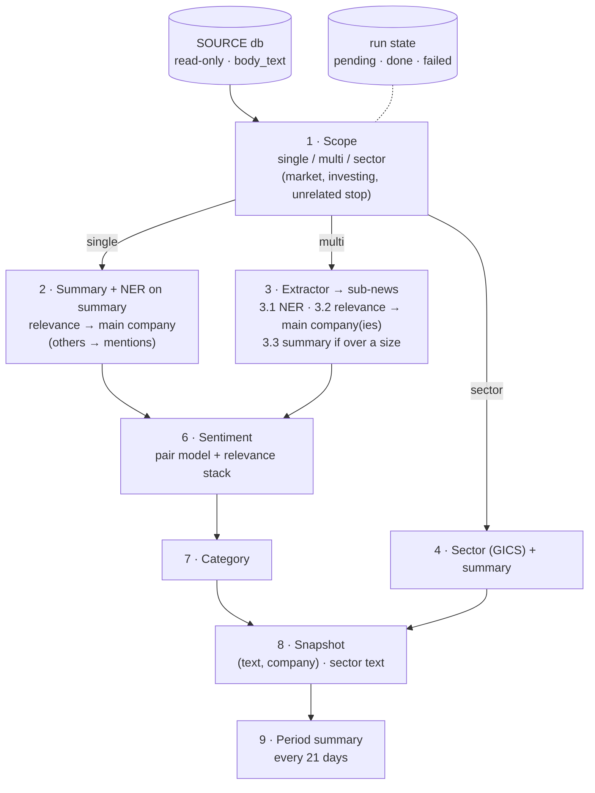

# SPEC.md — `portfolio-nlp`

Part of the thesis *"Sistema inteligente para la optimización de la inversión
en portafolios mediante integración de información financiera estructurada y
no estructurada de acciones del S&P500"* — Gabriel Jaime Múnera González &
Dovaribi Carupia Yagari, Universidad Pontificia Bolivariana (UPB). Referred
to elsewhere in this document and the architecture artifacts by its working
nickname, "Portfolio Thesis."

The technical contract for this repository: requirements, architecture, data
model, and acceptance criteria. Where `.specify/memory/constitution.md` is
the philosophy/principles/code-style layer this repo commits to regardless of
feature, this document is the "what, precisely" layer for the system it
implements — every requirement below should be traceable to a test, and every
design decision should be explainable by a principle in the constitution.
Link liberally: a design choice justified by, e.g., the constitution's
Architecture or Security & Data principles is annotated `(constitution: …)`
below rather than re-argued here.

Requirement IDs (`FR-0xx` functional, `NR-0xx` non-functional) are stable —
don't renumber an existing one, even if it's later superseded; mark it
superseded in place instead. Reference them in commits/PRs/tests
(`test_two_tier.py::test_source_readonly  # FR-007`) so a reviewer can trace
implementation back to requirement and requirement back to test.

---

## 1. Overview & Purpose

`portfolio-nlp` is the semantic layer of a six-repository system (the
"Portfolio Thesis") that builds and maintains an S&P 500 portfolio on top of
a knowledge graph. Data flows in one direction through the system:

```
sources (Wikipedia/news/Finnhub/SEC EDGAR)
  → portfolio-data-mining      (acquisition: discovers URLs, extracts article text)
  → portfolio-nlp              (THIS REPO — semantic layer)
  → portfolio-financial-analysis (fundamentals/pricing/cycle/quant → SEMANTIC score input)
  → portfolio-knowledge-graph   (RDF/OWL projection + SPARQL evidence surface)
  → portfolio-reports           (as-of run engine, per-name evidence, HTML report)
  → portfolio-app                (thin Streamlit client)
```

with one feedback edge running back up (a user-defined decision criterion,
compiled once in `reports` and propagated into `financial-analysis` and the
knowledge graph) — out of scope for this repo, noted here only for context.

**What this repo is for**: raw news article text is not usable as a
portfolio-decision input on its own. `portfolio-nlp` turns
`articles.body_text` (owned and crawled by `portfolio-data-mining`) into
structured, per-article and per-sector-week signals — sentiment, named
entities, a fixed-taxonomy category, and opt-in summaries — with per-row
model provenance (`model_name`, `processed_at`) and a human-correction path,
so that everything downstream (today: `financial-analysis`'s SEMANTIC score;
designed but not yet built: the knowledge-graph's per-`(asset, day)`
aggregation) can treat the result tables as a stable, auditable contract
rather than re-deriving meaning from raw text itself.

**What this repo is explicitly not**: it does not discover URLs or crawl
pages (`portfolio-data-mining`'s job — this repo treats `articles` as
pre-populated, read-only input); it does not aggregate results across assets
or time into portfolio-level signals (`financial-analysis` and
`knowledge-graph`'s job); it makes no portfolio or trading decision.

## 2. Scope & Requirements

### 2.1 In scope

- Batch NLP over pre-populated article text. **Target (D39, FR-020/FR-021): a stepped pipeline** (scope, summary, NER, relevance, sub-news extractor, sentiment, category, snapshots, period summary), one command per step, tracked and idempotent. **Code today (v1):** five stages (sentiment, NER, category always run; summaries opt-in), each writing its own result table, idempotent and resumable, until the backfill (T-150).
- The two-tier SOURCE (read-only)/RESULTS (read-write) database contract.
- A FastAPI serving layer (query + human-correction endpoints) that works
  off the RESULTS store alone.
- An LLM-as-judge accuracy-evaluation subsystem (`news_nlp.eval`), opt-in at
  the dependency-group level.

### 2.2 Out of scope

- URL discovery / page crawling / article extraction (`portfolio-data-mining`).
- Cross-asset or cross-time aggregation of NLP output into a portfolio
  signal (`portfolio-financial-analysis`, `portfolio-knowledge-graph`).
- Any UI (`portfolio-app`) or report rendering (`portfolio-reports`).
- Training the four models from scratch (`train_ner.py` fine-tunes the NER
  head but is a standalone script, not part of the pipeline).

### 2.3 Functional requirements

| ID | Requirement | Acceptance criteria |
|---|---|---|
| **FR-001** | **Removed (owner, T-220 PR B, 2026-11-18):** the v1 sentiment stage (`article_sentiment`). Full text: `archive/SPEC-rows-removed-by-the-v1-removal-2026-11-18.md`. | n/a |
| **FR-002** | **Removed (owner, T-220 PR B, 2026-11-18):** the v1 NER stage (`article_entities`). Full text: `archive/SPEC-rows-removed-by-the-v1-removal-2026-11-18.md`. | n/a |
| **FR-003** | **Removed (owner, T-220 PR B, 2026-11-18):** the v1 category stage, two-level zero-shot (`article_category`). Full text: `archive/SPEC-rows-removed-by-the-v1-removal-2026-11-18.md`. | n/a |
| **FR-004** | **Removed (owner, T-220 PR B, 2026-11-18):** the v1 `c_summary` stage (`article_summary`). Full text: `archive/SPEC-rows-removed-by-the-v1-removal-2026-11-18.md`. | n/a |
| **FR-005** | **Removed (owner, T-220 PR B, 2026-11-18):** the `sector_summary` stage. Full text: `archive/SPEC-rows-removed-by-the-v1-removal-2026-11-18.md`. | n/a |
| **FR-006** | Every stage is idempotent and resumable: it processes only rows missing from its own result table (or below `format_version`/needing a schema migration self-heal for `sector_summary`/`eval_run`/`article_category`). | Running the pipeline twice on unchanged input produces no duplicate or changed rows; a `sector_summary` row below `SECTOR_SUMMARY_FORMAT_VERSION` regenerates via `INSERT OR REPLACE` on the next run with no separate backfill script. |
| **FR-007** | The pipeline reads article text from a read-only-ATTACHed SOURCE store and writes results (plus a lean `articles` row per touched article) to a separate RESULTS store; SOURCE is never written. | `db.require_source_text` raises before any model loads if SOURCE is unset or has no usable `body_text` (constitution: Security & Data #2); an attached SOURCE is checked read-only before any query (`db.check_schema`: `PRAGMA user_version` at least 3 and the columns read, never cached, `test_schema_guard.py  # FR-007`; `POST /pipeline/run` answers 503 on a failure); a write attempt against schema `source` is not exercised by any code path (`grep` for `source\.` write statements returns none outside read paths). |
| **FR-008** | **Removed (owner, T-220 PR B, 2026-11-18):** the v1 FastAPI service (`apps/news_nlp_api.py`). Full text: `archive/SPEC-rows-removed-by-the-v1-removal-2026-11-18.md`. | n/a |
| **FR-009** | **Removed (owner, T-220 PR B, 2026-11-18):** manual corrections of the v1 tables (`news_nlp.corrections`). Full text: `archive/SPEC-rows-removed-by-the-v1-removal-2026-11-18.md`. | n/a |
| **FR-010** | **Removed (owner, T-220 PR B, 2026-11-18):** `news_nlp.eval` sampling, judging and metrics of the v1 stages. Full text: `archive/SPEC-rows-removed-by-the-v1-removal-2026-11-18.md`. | n/a |
| **FR-011** | Every ML-based stage (sentiment, NER, category, `c_summary`) is built on a shared Feature/Train/Inference (FTI) class hierarchy (`src/fti.py`); a stage with no real training (category, `c_summary`) has a documented no-op `Train`. | One abstract base per FTI component, a concrete subclass of all three in each of the four stages; `run_pipeline`'s behavior is unchanged and the hermetic tests pass. Full text: `archive/SPEC-condensed-for-the-pipeline-api-2026-11-17.md`. |
| **FR-012** | **Removed (owner, T-220 PR B, 2026-11-18):** `sector_summary` decoupled from the FTI hierarchy. Full text: `archive/SPEC-rows-removed-by-the-v1-removal-2026-11-18.md`. | n/a |
| **FR-013** | **Removed (owner, T-220 PR B, 2026-11-18):** eval scoring of a candidate through the FTI Inference classes. Full text: `archive/SPEC-rows-removed-by-the-v1-removal-2026-11-18.md`. | n/a |
| **FR-014** | The evaluation schema separates a sampled row's **model inference** (the prediction being evaluated) from its **LLM-judge verdict** into two distinct tables, both carrying `article_id` (traceable back to the SOURCE `urls.db` article — FR-007), a `task` column (`sentiment` \| `category` \| `ner` \| `c_summary`, plus `category_truth`, the opt-in calibration judge of T-141, which is outside `--stage all` and `GET /eval/latest`), and an `experiment` column (a free-form label — `base`, `v2`, `v3`, `v4`, …) identifying which model/candidate produced the inference, so multiple experiments' judged data can coexist in the same store instead of requiring a separate scratch database per candidate. | Two tables exist where `eval_judgement` used to hold both concerns in one row; every row in both carries a non-null `article_id`, `task`, and `experiment`; a query for two different `experiment` values against the same `article_id`/`task` returns two independent rows, not a collision (unique constraint keyed on `(article_id, task, experiment, run_id)` or equivalent, not just `article_id`). |
| **FR-015** | Before spending a judge LLM call on a sampled `(article_id, task, experiment)`, the eval module reuses the stored verdict only when the key **and** the candidate prediction are the same, so spend is not repeated, but a retrain into the same checkpoint path is never taken for the same judged thing (tightened 2026-09-19, T-109, §13 item 18). (Full text: `archive/SPEC-condensed-for-the-sentiment-step-2026-11-14.md`.) | The same `--stage <s> --run-name <experiment>` run twice on an unchanged sample makes zero new judge calls the second time (the judge client is never invoked for a key already stored); a new `article_id`, a different `experiment`, or an unchanged `experiment` whose prediction changed judges fresh, and a recorded verdict always matches its own run's prediction. |
| **FR-016** | For sentiment and category only, the eval module persists each experiment's full confusion matrix (one row per `(experiment, task, true_label, predicted_label)` cell) in its own table and stores one-vs-rest precision, recall, F1 and per-class ROC/AUC beside `accuracy_ovr`; NER and `c_summary` keep their metric sets unchanged. (Full text: `archive/SPEC-condensed-for-the-sentiment-step-2026-11-14.md`.) | The confusion-matrix table is keyed by `experiment` and queryable apart from `metrics_json`; a completed sentiment or category `eval_run` stores `roc_auc_<class>` beside the other per-class metrics; the metric key sets of `aggregate_ner` and `aggregate_c_summary` are byte-identical to before (a regression test on the exact key set). |
| **FR-017** | **Removed (owner, T-220 PR B, 2026-11-18):** the `ExperimentSpec` runner (`cli/run_experiment.py`). Full text: `archive/SPEC-rows-removed-by-the-v1-removal-2026-11-18.md`. | n/a |
| **FR-018** | The production pipeline's model selection (name, commit SHA, batch size per ML stage) lives in one git-tracked file, `config/pipeline_models.json` (read by step 7 and by `python -m setup`; `pipeline_config.py` and `pipeline.py` were removed by T-220 PR B); not a literal, not overridable by a CLI flag or env var (constitution AI #1 unchanged: changing a model is an edit to this file in a reviewed PR). `sentiment` has no `batch_size`. | The file is read by step 7 and by `python -m setup` (the validation and the monkeypatchable constants of `pipeline.py` went with it, T-220 PR B). The other pins are in their own `config/*.json`; the category step reads the `category` pin of this file. Full text: `archive/SPEC-condensed-for-the-period-fold-2026-11-16.md`. |
| **FR-014** to **FR-016** | *(T-220 PR B, 2026-11-18)* The eval **store** (the `eval_run`, `eval_inference`, `eval_verdict`, `eval_confusion` tables and their keys), the MLflow tracking and the judge model stay. The **sampling and the stages** that wrote the v1 tasks (`sentiment`, `category`, `ner`, `c_summary`, `sector_summary`) were removed with the v1 tables; only the blind step-7 category judge runs (T-222 rebuilds the rest). Their rows stay readable. | n/a |
| **FR-019** | For model selection and evaluation the metrics recorded, and used to choose between settings or models, are **Precision, Recall and ROC OVR** (the AUC of each class against the rest), per class (owner, 2026-11-09, `PLAN.md` D37). Accuracy is a description, not a selection metric. Built for the sentiment fine-tune's validation slice (`src/sentiment_pair_report.py`: per-class figures weighted by the draw's strata, the selection score as the macro mean of the nine, the paired gain with the gold's interval and verdict); the same metrics are already logged per class by `news_nlp.eval` for sentiment and category. |

| **FR-020** | **The pipeline (owner, 2026-11-10, PLAN D39 and D40), built in separate steps, Build 1 first.** **Build 1:** (1) scope of each unique body (`single`, `multi`, `sector`, `out_of_scope`; the last stops) and the sub-news of a `multi` one; (2) summary over 2,000 characters, shorter ones used as they are (`docs/summary_step.md`), DeepSeek (D44); (3) NER and relevance: tickers over a threshold are main (`news_company`, `is_main`), the rest mentions, none over it the review list; (4) the sector of a `sector` body (`body_sector`; `docs/sector_step.md`). **Build 2:** sentiment (FR-023), then category (FR-022). **Build 3:** snapshots and the period summary (FR-024). Each step has its own table. | Each step reads the stored result of the previous one and writes its own table; each step gives one row per item for fixed inputs; a single body or sub-news over the size has a `news_summary` row (`summary` or `original`); the main ticker is stored with its relevance score (`is_main`); a `sector` body has one `body_sector` row per revision; the D24 bar is open (T-167); the scope classifier meets the T-147 bar before step 1 is accepted. |
| **FR-021** | **Conditions of the pipeline (D39).** The advance of a run is tracked; every step is idempotent; steps are run one command each, with a limit, never 1 to 7 in one pass. | A status command (`cli/news_nlp_steps.py --status`, a query on `pipeline_step_state`) reports pending, done, failed, skipped and review per step and item (`review` is neither done nor failed, T-172); a new model revision adds a row and the latest is read; running a step twice on unchanged input adds and changes no row; no command runs all steps (tested); a step stopped halfway resumes without redoing finished items; a failed item is retried by the next run and keeps its reason (`Type: message`); a run stops when failures repeat (steps 1 and 2, the sector and the companies: 3 batches in a row, the cut: 10 bodies in a row); step 2 reads the sub-news of a cut named with `--cut-revision`, and `--sector-revision` for the sector bodies, never the latest, and refuses an option it does not read; the cut marks a body with no company text `skipped` ("no company text"), which is not retried at that revision; `--status` of a step with several revisions shows the latest and lists the others (tests in `test_steps.py`, `test_cut.py`, `test_summary_step.py`, `test_sector_step.py`); the cut reads a body as `units5` unless `--reading units4` or `--reading units` is given (T-177), prints its reading and revision before it starts, and the reading is the start of its revision (a test asserts the default, the start line and the distinct revisions). |
| **FR-022** | **The category step (PLAN D43, T-203).** `--step category --summary-revision R --companies-revision C` writes one `news_category` row per (text, main company): one of 12 labels (D15's 14, two read as `other`; never `uncertain`), its score, its group (6), `group_score` (the mass share of the group, **not** the v1 softmax) and the per-label scores; no main company, no row; a blank text is `skipped`. The model is the fine-tune of `config/category_step.json`, pinned though the bar is not met. | Idempotent and resumable (the revision follows the scoring and the two input revisions only: `docs/category_step.md`); a GPU fault stops the run and marks nothing failed; a pair read cut at the model's window is recorded in `slug_scores`; a consumer reads one complete revision (`docs/category_step.md`); agreement with the owner's labels is reported against the bar of D24 (not met: 54.1% held-out, `docs/category_training.md`). |
| **FR-023** | **The sentiment step (PLAN D39 (6), T-168).** `--step sentiment --summary-revision R --companies-revision C` writes one `news_sentiment` row per (text, main company): `positive`, `negative` or `neutral`, its score and the stack's probabilities (local pair model, never downloaded, with step 3's relevance score) (`config/sentiment_stack.json`); no main company, no row; a blank text, no sentence or no company of the universe is `skipped`; refused if the universe is empty or step 3 read another summary revision. | Idempotent and resumable (the revision follows the model, the stack, the two input revisions, the names of the scored companies and the scoring code and cut of the text: `docs/sentiment_step.md`); an unpinned folder is refused. Figures: cross-validation only (0.814, all marked pairs, not main pairs alone); gold not scored (T-148c4, T-193). |
| **FR-024** | **The snapshot and the period summary (PLAN D42; `docs/snapshot_steps.md`).** `--step snapshot`: `news_snapshot`, one row per (text, main company) or `sector` text (publication date, title, text, mentions (T-198), category, sentiment; a sector text has neither). `--step period`, every 21 days from 2022-01-03 at a fixed 15:00 in `BATCH_TIMEZONE` (default `America/New_York`): `period_summary`, counts per company and per sector (summed from the companies; no LLM); four weak categories count as `other` (T-215, D42). State is derived from the tables (exception to FR-021: per pair). | A written period is never rewritten; `period_item` says which period counted what; reruns add nothing; a revision with no rows is refused. T-195 to T-199. |
| **FR-025** | **The pipeline API (PLAN D45; `docs/pipeline_api.md`).** `apps/pipeline_api.py` runs each step, the whole pipeline (in order) and the stage models (`scope`, `sector`, `companies`, `category`, `sentiment`: ad-hoc items, no row written). A step runs through the CLI's own parser and `main_<step>` function; revisions are explicit; one job at a time (a second is 409), in memory; no authentication; `fetch`, `model_dir`, `allow_unpinned`, the store paths and `reset` stay with the CLI (exact option names only; the summary needs a bounded `max_calls`). | An option the CLI refuses is a 422 with its message; a run writes the CLI's rows; a pipeline job stops at the first failure; `/health` answers; the v1 API stays until T-220. T-219. |

### 2.4 Non-functional requirements

| ID | Requirement | Acceptance criteria |
|---|---|---|
| **NR-001** | Only one model is resident on the accelerator at a time; a stage with nothing pending never loads its model. | Manual/profiled check: peak process VRAM during a single-stage run stays within a 6 GB budget; a pipeline run with zero pending rows for a stage shows no corresponding model-load log line. |
| **NR-002** | Every stage produces *correct* output on CPU, not just on GPU (`DEVICE` falls back to CPU when CUDA is unavailable). | `uv run pytest` (hermetic, monkeypatched models, no GPU) is green on a CPU-only CI runner — the actual gate today; a slower non-hermetic full-model CPU smoke run is out of scope for CI. |
| **NR-003** | The test suite requires no network access and no GPU. | `.github/workflows/ci.yml`'s `pytest -q` job passes on `ubuntu-latest` with no GPU and no outbound calls beyond `uv sync`. |
| **NR-004** | Chunking must handle articles far past a model's token limit (observed up to ~13K words) without silent truncation. | A synthetic long-body fixture (well past 512 tokens) processes through sentiment/NER/category with `chunking.py` producing sentence-boundary-packed chunks and no unrecorded truncation. |
| **NR-005** | Heavy/optional dependencies (`strands-agents`, `mlflow`) never load unless the caller actually invokes evaluation. | `import pipeline` / `import apps.news_nlp_api` succeeds in an environment with only the base `[project]` dependencies installed (no `eval` group) — `news_nlp.eval.run_eval` is imported lazily. |
| **NR-006** | A DB-engine change (away from SQLite) must not require touching this repo's stage/query logic — only a `portfolio-common` version bump. | `grep -rn "import sqlite3" src apps cli` returns nothing; every engine-specific SQL fragment goes through `conn.dialect` / `portfolio_common.db` helpers. |
| **NR-007** | `tests/` is covered by the same static-type gate as `src`/`apps`/`cli` — a test asserting against the wrong connection type is caught by `mypy`, not left to a hermetic test happening to still pass at runtime despite the wrong declared type. | `uv run mypy --config-file=.code_quality/mypy.ini` (the project's own documented command, no path argument) reports zero errors with `tests` added to `.code_quality/mypy.ini`'s `files` setting; `scripts/` stays deliberately out of scope (one-shot historical scripts, `CLAUDE.md`'s own `scripts/` convention). |

## 3. Technology Stack & Architecture Decisions

Full stack and rationale: `.specify/memory/constitution.md` §Technological
stock. Summary for traceability:

- **Runtime**: Python `>=3.12,<3.13`, `uv`-managed (`uv.lock` committed).
- **ML/NLP**: PyTorch (`cu124` wheel pin) + `transformers` for all four
  models — chosen because every model ships as a `transformers` checkpoint;
  a different framework would mean re-hosting each one.
- **Serving**: FastAPI + `uvicorn`, `pydantic` request/response models.
- **Storage**: SQLite, accessed exclusively through `portfolio_common.db`'s
  `Dialect`/`TwoTierDatabase` seam (git-tag-pinned `portfolio-common`) — no
  raw `sqlite3` anywhere in `src`/`apps`/`cli` (NR-006).
- **Evaluation** (opt-in group): `strands-agents[openai]` (the judge LLM
  client) + `mlflow` (run tracking).

Architecture decisions this repo has already made and should not be
re-litigated without a constitution amendment:

- **The DB layer is vendored, not a dependency.** `src/news_nlp/` owns
  schema/queries/taxonomy directly; `portfolio_common` supplies
  only the engine-agnostic `Database`/`Dialect`/`Allowlist` primitives
  underneath it. (History: this code moved out to `portfolio_common.news_nlp`
  and back once already — see `docs/legacy/portfolio-common-v1-migration-plan.md`.)
- **Two physical databases, not one.** SOURCE (`urls.db`, the crawler's
  full corpus, has `body_text`) and RESULTS (`nlp.db`, a lean serving store)
  stay physically separate by design (constitution: Architecture #3) — not a
  migration debt to collapse.
- **Stage stack is a fixed pipeline, not a DAG/orchestrator.** The steps run one command each, in a fixed order (`cli/news_nlp_steps.py`, FR-020, FR-025); no task queue, no distributed execution. Justified by corpus
  scale and the "one model resident at a time" VRAM constraint (NR-001).

**The FTI hierarchy (FR-011, built).** `src/fti.py` holds the Feature/Train/Inference base classes. The v1 stage modules and `pipeline.py` that used them were removed by T-220 PR B, except the classes inside `ner_stage.py` and `summary_stage.py` that the step revisions hash. The `sector_summary` module of FR-012 was removed with the stage.

## 4. System Architecture

**Target pipeline (PLAN D39, FR-020; not built).** Each arrow is a separate command; a step reads the stored result of
the one before it (never one pass 1 to 7), and run state is tracked (FR-021).



**The v1 chain** (`run_pipeline`: sentiment, NER, category in one process) was removed by T-220 PR B; its diagram and reading are in `archive/PIPELINE-superseded-2026-11-10.md` (section 4).

## 5. Data Model

Canonical DDL: `src/news_nlp/schema.py` (`build_schema`). The five v1 result
tables key off `article_id INTEGER REFERENCES articles(id)` (dropped by T-220 PR C; the stepped pipeline's tables are listed below); `articles`
itself is **not** created by this repo (SOURCE owns the full row with
`body_text`; RESULTS holds a lean, `body_text`-free subset populated
row-by-row on first result write for that article).

### SOURCE `articles` schema contract

`require_source_text` verifies `articles.body_text` before a run (the run aborts if the column is absent or every row is blank, FR-007). The steps read what they need from SOURCE as their own docs say (`docs/*_step.md`); the table of what the v1 `sector_summary` read (`ticker`, `company`, `gics_*`, `pub_date`, `fetched_at`) was removed with the stage.

**Rows for `article_sentiment`, `article_entities` (and its target columns), `article_category`, `article_summary`, `sector_summary` and `eval_judgement` describe tables that T-220 PR C drops; they stay here until it runs.**

| Table | Key | Notable columns | Written by |
|---|---|---|---|
| `article_sentiment` | `article_id` (PK) | `label`, `score`, `positive`/`negative`/`neutral`, `model_name`, `processed_at` | Stage 1 |
| `article_entities` | `id` (PK, autoincrement) | `article_id` (FK, indexed), `entity_type` (`PER`/`LOC`/`ORG`), `text`, `start_char`/`end_char`, `score` | Stage 2 |
| `article_entities` target columns (D39 (iii), approved 2026-11-10) | same key | adds nullable `sub_news_id` and `ticker`; **unused since 2026-11-13** (owner: step 3 does not store the raw NER spans, `news_company.mention_count` keeps the count); `score` stays the NER confidence | none |
| `body_scope` (created by `init_schema()`, #162; approved 2026-11-10, D40) | `body_hash` (unique body, T-132), `classifier_revision` | `scope` (`single`/`multi`/`sector`/`out_of_scope`), per-class `score`s, `text_used` (`title` or `title+N`), `processed_at` | Step 1 |
| `body_sector` (owner 2026-11-13) | `body_hash`, `classifier_revision` | `status`, `sector`, `candidate`, `margin`, `vote_sector`, `scores`, `votes`, `processed_at` | Sector |
| `sub_news` (target, approved 2026-11-10) | `id` (PK) | `body_hash` (the unique body), `article_id` (FK: the lowest article id of the body's group, T-132), `segment_index`, `text`, `extractor_revision`; unique (`body_hash`, `segment_index`, `extractor_revision`); `id` is the `item_id` of a sub-news; a new revision writes new rows, the old ones are not read and their dependent steps are re-queued | Step 1 |
| `news_summary` (target, approved 2026-11-10) | (`item_kind`, `item_id`, `model_revision`) | `summary_text`, `text_source` (`summary` or `original`), `num_chunks`, `processed_at`; `item_kind` is `body` or `sub_news` (a sector body is a body) | Step 2 (single bodies, sub-news); the sector body's row is written by step 2 |
| `news_summary_call` | as `news_summary` | `api_model`, `model_asked`, tokens | Step 2, API |
| `news_company` (target, owner 2026-11-10) | (`item_kind`, `item_id`, `ticker`, `model_revision`) | `relevance_score`, `is_main` (the **only** source of the main ticker; one main row per text and ticker is the key), `mention_count`, `processed_at`; no company over the threshold: no `is_main` row and status `review` | Step 3 |
| `news_sentiment` (approved 2026-11-10; `--step sentiment`) | (`item_kind`, `item_id`, `ticker`, `model_revision`); `ticker` is `''` for a sector item (never NULL: two NULLs do not collide in a SQLite key, and the rerun test would fail) | `label`, `score`, `positive`/`negative`/`neutral` (D37 reads them per class), `model_name`, `sentiment_checked`, `processed_at` | Sentiment |
| `news_category` (approved 2026-11-10; `--step category`, provisional) | (`item_kind`, `item_id`, `ticker`, `model_revision`), `ticker` as in `news_sentiment` | `label`, `score`, `group_label`/`group_score`, the per-slug scores (audit trail; plus the reserved key `_truncated_chunks`, FR-022), `model_name`, `processed_at` | Category |
| `news_snapshot`, `period_summary`, `period_run`, `period_item`, `sector`, `company_sector` (built, T-195, T-196; FR-024) | keys and columns: `docs/snapshot_steps.md` | the same | Snapshot, Period |
| `pipeline_step_state` (target, approved 2026-11-10, D39 (v)) | (`item_kind`, `item_id`, `step`, `model_revision`) | `status` (`pending`/`done`/`failed`/`skipped`/`review`), `attempts`, `error`, `started_at`, `finished_at`; `item_kind` is `body` (`item_id` = the **body hash**, T-132: a body under five tickers runs once), `sub_news` (`item_id` = `sub_news.id`) or `text_company` (`item_id` = `<item_kind>:<item_id>:<ticker>`: sentiment and category run per pair, so a text with two main companies has two rows); `item_id` is text | `cli/news_nlp_steps.py` |
| `article_category` | `article_id` (PK) | `label` (9 slugs or `other`), `score`, `group_label`/`group_score` (level-1 hierarchy), 9 raw per-slug NLI scores (audit trail) | Stage 3 |
| `article_summary` | `article_id` (PK) | `summary_text`, `num_chunks`, `model_name`, `processed_at` | Stage 4 (opt-in) |
| `sector_summary` | `id` (PK); `UNIQUE(gics_sector, gics_sub_industry, week_start)` | `summary_text`, `facts_json` (structured, non-narrative), `intro_text` (deterministic template as of 2026-09-14, `model_name` reads `"deterministic-template"`), `format_version` (self-heal marker), `num_articles`/`num_companies` | Stage 5 (opt-in) |
| `eval_run` | `id` (PK) | `stage`, `sample_size`, `judge_model`/`judge_url`, `code_version`, `mlflow_run_id`, `metrics_json`, `strata_json`, `status` | `news_nlp.eval` |
| `eval_judgement` | `id` (PK) | `run_id` (FK), `article_id` (not FK-constrained — snapshot semantics), `bucket`, `verdict_json`, `correct`, `severity`, `rationale` | `news_nlp.eval` |

**Category taxonomy** (`news_nlp.taxonomy`): 3 top-level groups →
`corporate_actions`, and others documented in `docs/legacy/category-taxonomy-v1.md` →
9 leaf slugs total, classified in two NLI passes (level-1 group, then level-2
leaf within the article's top-2 groups) against a calibrated confidence
threshold (`CATEGORY_CONFIDENCE_THRESHOLD`, currently 0.6 — see §13 for the
calibration history); anything below threshold at the leaf level resolves to
`other`.

**Relationships**: every result table's `article_id`/`article_id`-derived FK
points at RESULTS' lean `articles(id)` copy, not directly at SOURCE — a
result row is valid even after SOURCE is detached or rotated. `eval_run` →
`eval_judgement` is a real FK (a run's judgements die with the run); neither
references `articles(id)` (a judged sample is a point-in-time snapshot; the
underlying row may be corrected or reprocessed afterward — see FR-009/010).

Full topology (SOURCE vs. RESULTS, connection lifecycle, env vars):
`docs/db-topology.md`.

**Planned (§13 item 15, FR-013–FR-016, not yet built)**: `eval_judgement`
splits into two tables — one for the sampled model **inference** being
evaluated, one for the LLM **judge** verdict on it — each carrying
`article_id`, `task`, and `experiment` columns, plus a new confusion-matrix
table (sentiment/category only, keyed by `experiment`). `PLAN.md` Work item
10 has the concrete design; this note exists so a reader of this section
knows the two-table `eval_run`/`eval_judgement` shape above is the
*current*, soon-to-be-superseded contract, not treated as permanent.

## 6. Core Workflows

**Batch pipeline run, target (D39, FR-020/FR-021):** one command per step (`cli/news_nlp_steps.py`: `--step`, `--limit`, `--status`; the v1 CLI was removed by T-220 PR B); a step opens RESULTS and
attaches SOURCE read-only, takes the items with no row of its own for the pinned model revisions, writes them and records
their state; a rerun redoes nothing; no command runs every step.

**Serving and the pipeline API:** `apps/pipeline_api.py` (FR-025) runs each step, the whole pipeline and the stage models; the v1 serving, correction and evaluation workflows (the query endpoints, `corrections`, `cli/news_nlp_eval.py`) were removed by T-220 PR B.

## 7. Business Logic & Algorithms

- **Sentiment** (the steps): the pair model and the relevance stack of `docs/sentiment_step.md` (FR-023).
- **NER**: BIO-tag merge is **word-boundary aware**
  (`merge_bio_predictions`, fixed `82c5e6a`) — sub-token predictions are
  merged only within a single source word, so a numeral or partial token
  can no longer be emitted as a standalone entity.
- **Category** (the steps): the entailment model of step 7 over 12 labels (FR-022); the two-level zero-shot of v1 is in `docs/legacy/category-taxonomy-v1.md`.
- **Self-healing schema drift**: `sector_summary.format_version`,
  `eval_run.strata_json`'s additive migration, and `article_category`'s
  `group_label`/`group_score` additive migration all follow the same
  pattern — `Database.ensure_columns` (no-op if already current), with
  `sector_summary` additionally treating any row below the current
  `SECTOR_SUMMARY_FORMAT_VERSION` as stale and regenerating it via
  `INSERT OR REPLACE` on next run (no separate backfill script; contrast
  `article_category`'s additive-only migration, which does **not**
  auto-reprocess legacy rows — see §13).

## 8. Error Handling & Resilience

Governing principle: **fail loudly, never swallow silently**
(constitution: Security & Data #2). Concretely in this repo:

- `require_source_text` raises `RuntimeError` **before any model loads** if
  SOURCE is unset, unreachable, or has no non-empty `body_text` — the
  common misconfiguration (pointing a text stage at the results store) is
  caught immediately, not after minutes of model loading.
- No stage function catches and discards a model-inference exception to
  "keep the batch going" — a failure aborts the run rather than silently
  producing an incomplete or wrong result set. (The steps record a failed item in `pipeline_step_state` and go on with the rest, FR-021; the v1 `pipeline.py` that aborted on one bad row was removed by T-220 PR B.)
- `eval_run.status` is an explicit `running`/`ok`/`error` state machine with
  an `error` text column — an evaluation run that fails records *why*, it
  doesn't just vanish or leave a half-populated row masquerading as `ok`.
- The two-tier connection's `finally: db.detach_source(conn); conn.close()`
  guarantees SOURCE is detached and the connection released even when a
  stage raises mid-run.

## 9. Performance & Scalability Expectations

This repo has no throughput/latency SLA, and defining one is out of scope
(§14) — a real-time or high-volume performance target belongs to a
production system this project isn't. What exists instead is a documented
**accuracy baseline** from the first full-corpus evaluation run
(`docs/evaluation.md`, 2026-09-08, n=1000/stage) — treat a *drop* against
these as a regression signal, not the absolute numbers as a pass/fail bar:

| Stage | Headline metric | Baseline value |
|---|---|---|
| sentiment | `recall_negative`¹ | 0.62-0.78 pre-fix; **merged 2026-09-13: fine-tuned model + chunk-level entity-scoped weighting** — 0.808 recall_negative / 0.513 precision_negative / 0.801 recall_positive / 0.731 macro F1 vs. judge, chosen over a higher-precision title-only alternative (0.619/0.670 precision, but only 0.574/0.528 recall) for deliberately pessimistic, both-classes-strong recall (§13 item 1 — see `PLAN.md` Work item 4, `docs/evaluation.md`'s 2026-09-13 follow-ups) |
| category | `accuracy_vs_judge` | 0.487 post-hierarchical-fix + 0.6 threshold calibration (§13 item 2, resolved — was 0.69/0.47 pre-redesign) |
| ner | `micro_f1` | 0.858 (hallucination rate 16.0%) post-subword-fragmentation-fix, n=8000 against the T-025 resample pool (`PLAN.md` Work item 3, resolved 2026-09-12 — was 0.74/33.8% pre-fix, `TASKS.md` T-020; only the 19,988-article resample is post-fix, the remaining ~439K articles are not, `TASKS.md` T-022) |
| c_summary | `mean_faithfulness` | 4.87/5 pre-fix (old sampling design) → **4.78/5 post-fix (2026-09-14, eval_run 34, HT)**; coverage improved 3.02→3.64/5 but hallucination rate rose 5.4%→8.5% (§13 item 10, resolved 2026-09-14 as an accepted trade, not a fix — see `PLAN.md` Work item 6 and `docs/evaluation.md`'s 2026-09-14 "Decision" follow-up) |
| sector_summary (`intro_text` only) | `mean_faithfulness` | 4.05/5 → **3.83/5 on fresh sentiment data** (`pct_with_hallucination` 42.2%→50.2%, confirming the pattern was independent of the underlying data), root-caused to `distilbart-cnn-12-6` paraphrasing a synthetic stats seed it wasn't trained for. **Fixed 2026-09-14**: `intro_text` is now `build_sector_intro_seed`'s own deterministic output, never model-paraphrased — zero hallucination risk by construction (§13 item 12, resolved) — `PLAN.md` Work item 6, `docs/evaluation.md`'s 2026-09-14 follow-ups |

¹ `docs/evaluation.md`'s "Why recall, not F1, for sentiment negative"
(2026-09-08) explains the switch from `macro_f1_vs_judge` (0.40 at the
original 2026-09-08 baseline, still logged every run) to `recall_negative`
as the metric `--check-regression` actually gates on.

Resource expectations that *are* enforced by design (NR-001, NR-004): single
model resident on the accelerator at a time (6 GB VRAM budget), chunked
processing for articles up to ~13K words. No articles/sec or API-latency
number is stated anywhere in this document — none has been measured, and
inventing one with no load test behind it would be worse than stating
plainly that none exists (§14).

## 10. Testing Strategy & Acceptance Criteria

- **Hermetic by construction** (NR-002/NR-003): `tests/news_nlp/conftest.py`
  builds a minimal `articles` table plus two-tier SOURCE/RESULTS fixtures;
  every model load is monkeypatched. No network, no GPU, no real HF
  download in `uv run pytest`.
- **Coverage mapping**: `test_schema.py`/`test_db.py`/`test_env.py` are the vendored `news_nlp` package's own unit tests (FR-006/007); the step tests (`test_*_step.py`, `test_steps.py`) and `test_pipeline_api.py` cover FR-020 to FR-025; `test_eval_*.py` cover the eval store, the tracking and the judges with the LLM and MLflow mocked; `test_revision_guard.py` pins the revisions.
- **New requirement → new test first** (constitution: Quality & Testing
  #1) — a change implementing or altering an FR/NR above should land with a
  test that references the requirement ID in a comment or test name.
- **Coverage floor**: 80% on changed/new `src/` code per PR (constitution:
  Quality & Testing #3).
- **Acceptance criteria in §2.3/§2.4 are the test spec** — each row should
  be directly expressible as one or more `pytest` assertions; a PR claiming
  to satisfy an FR/NR without a corresponding test is incomplete.
- **Accuracy regression:** the CLI and the scheduled gate were removed by T-220 PR B; the step-7 judge is run by hand (`scripts/category_judge_2026_11_15.py`), T-222 rebuilds the rest.

### Reproducing the accuracy baseline

The §9 baseline was produced by the eval CLI removed by T-220 PR B. The stored runs stay in the `eval_*` tables and in MLflow (experiment names `news_nlp_eval/<stage>`); to repeat one, check out commit `81294eb`.

## 11. Deployment Procedures

There is no formal CD pipeline for this repo yet; what exists:

1. `uv sync` (+ `uv sync --group eval` if evaluation is needed).
2. `uv run python -m setup` — pre-download the four HF model checkpoints
   (by name, not pinned commit SHA — see §13).
3. Configure `.env` (or real environment) with `$DATABASE_URL` /
   `$SOURCE_DATABASE_URL` (required for the text-reading stages; not
   required for the steps that read only the RESULTS store — `docs/db-topology.md`).
   Optionally `$HF_TOKEN` (read scope lifts anonymous Hub rate limits for
   step 2; write scope is required by `scripts/publish_*.py`).
4. Run `uv run apps/pipeline_api.py` (long-lived service, `:8003`) and/or `uv run cli/news_nlp_steps.py --step <step>` on whatever cadence the batch run needs (a scheduler is the owner's).
5. CI gate before merge (`.github/workflows/ci.yml`, `master`/PRs):
   `uv sync --group dev --group eval` → `ruff check` → `ruff format --check`
   → `mypy` → `pytest -q`. No workflow runs the real LLM-as-judge evaluation (`eval.yml` was removed by T-220 PR B).

## 12. Dependencies & Integrations

- **Upstream (required)**: `portfolio-data-mining`'s `articles` table
  (SOURCE, via `$SOURCE_DATABASE_URL`) — this repo has no contract pinning
  its shape beyond `body_text` existing and being non-empty (FR-007); other
  columns (`gics_*`, `pub_date`, …) that the lean-copy and stages depend on
  are unpinned (§13).
- **Upstream (library)**: `portfolio-common`, git-tag-pinned in
  `pyproject.toml` (`[tool.uv.sources]`) — a DB-engine-contract change here
  is an explicit, reviewed re-pin, never a floating version.
- **Downstream (consumers, read-only via this repo's tables/API)**:
  `portfolio-financial-analysis` (SEMANTIC score input, today reads
  `article_sentiment`/`article_category` directly); `portfolio-knowledge-graph`
  (designed but not yet built: per-`(asset, day)` aggregation of the same
  tables).
- **External services**: Hugging Face Hub (model downloads, `setup.py`);
  an OpenAI-compatible LLM endpoint (`$LLM_API_KEY`/`$LLM_MODEL`/`$LLM_URL`,
  evaluation only); MLflow tracking (`$MLFLOW_TRACKING_URI`, local file
  store by default, evaluation only).
- **No dependency on**: any repo downstream of `financial-analysis`
  (`knowledge-graph`, `reports`, `app` never call into this repo directly).

## 13. Open Questions & Risks

Carried forward from the last recorded architecture review
([the repository artifact](https://claude.ai/code/artifact/65e62819-28dd-495b-b6ec-64f9c1751235))
and this document's own drafting — resolve or explicitly accept before
treating a related FR/NR as done:

1. **Sentiment was the weakest stage** (`macro_f1_vs_judge` 0.40: FinBERT's whole-article softmax average has no per-company or net-signal reasoning). **Resolved and merged 2026-09-13:** chunk-level entity-scoped weighting with the fine-tuned `gamug/FinBERT-financial-news` is the production candidate (recall 0.808 negative and 0.801 positive), chosen over the title-only variant because this pipeline is deliberately pessimistic (a missed story is a blind spot, a false alarm can be discounted). `PLAN.md` Work item 4, `TASKS.md` T-030–T-038, `docs/evaluation.md`'s 2026-09-13 follow-ups. Sentiment over the per-company texts and its retraining on summaries continue in Work item 18 (T-148c). Full text: `.specify/memory/archive/SPEC-open-questions-2026-11-08.md`, item 1.

2. **Four category leaf labels were near-guessing** (accuracy 0.14 to 0.33) after the hierarchical redesign. **Resolved 2026-09-12** (the 0.6 threshold was calibrated, `PLAN.md` Work item 5); `capital_shareholder_returns` recall (0.293) stays weak. The open thread, `other`'s own precision (0.474, T-041), is superseded by item 19, `PLAN.md` Work item 15 and Work item 18. Full text: `.specify/memory/archive/SPEC-open-questions-2026-11-08.md`, item 2.

3. **No SOURCE `articles` contract beyond `body_text`.** Stages and the
   lean-copy depend on `gics_*`/`pub_date`/etc. existing with compatible
   types, but nothing pins or validates that shape (relates to FR-007).
4. **Model checkpoints are unpinned to a commit SHA** — **resolved
   (2026-09-14)**: `pipeline.MODEL_REVISIONS` pins all four models
   (sentiment/NER/category/summarization) to a commit SHA, fetched from
   the HF Hub API at pin time; passed as `revision=` at every
   `from_pretrained` call site in `src/pipeline.py` and both calls in
   `src/setup.py`'s `download_models()` — an upstream Hugging Face update
   to any of these repos can no longer silently change results out from
   under the §9 accuracy baseline. `PLAN.md` Work item 1, `docs/modules/
   news-nlp.md`'s "Model pins" table has the exact SHAs. The other half
   of this item (reprocessing historical data against a newly-pinned SHA
   if it ever diverges from what was actually used) remains explicitly
   out of scope — §14. **Relocated (2026-09-21)**: the name/revision/
   batch-size constants this item pinned now live in the git-tracked
   `config/pipeline_models.json`, schema-validated by
   `src/pipeline_config.py` and loaded by `pipeline.py` at import time —
   FR-018, `PLAN.md` Work item 14. A format change only (Python literals →
   JSON, still PR-reviewed, no runtime override) — constitution
   AI-behavior #1 ("pinned, not dynamic") required no amendment.
5. ~~No throughput/latency SLA~~ — **retired, not an open question.** A
   throughput/latency SLA is a production requirement; this project doesn't
   have a production phase to require one for (§14). Kept here, struck
   through, only so the item number stays stable for anything that already
   references it.
6. **`article_category`'s additive schema migration does not
   auto-reprocess legacy rows** (unlike `sector_summary`'s
   `format_version` self-heal) — pre-hierarchical-classifier rows read back
   `group_label=''`/`group_score=0.0` and stay that way until a (not yet
   built) backfill runs.
7. **No scheduled cadence for `--summarize`** — stages 4–5 only populate on
   a manually-triggered run; `sector_summary`'s "closed week" semantics
   assume something runs at least weekly, but nothing enforces that.
8. **`--check-regression` isn't wired into `ci.yml`** — an accuracy
   regression can merge undetected; today's gate is a human remembering to
   run `news_nlp_eval` before/after a model or prompt change.
9. **Per-article failure isolation is unmodeled** (§8) — a single
   malformed row currently fails the whole batch run rather than being
   skipped-and-logged; unclear whether that's the intended trade-off at
   larger corpus sizes.
10. **`c_summary`'s `mean_coverage` is weak (3.02/5)** with strong faithfulness (4.87/5, 5.4% hallucination): a terse/extractive tendency of `distilbart-cnn-12-6`, not a correctness problem. Its suspected full-article-vs-lead-cap eval-sampling mismatch was confirmed and fixed 2026-09-14, and `sector_summary`'s `intro_text` got a faithfulness-only check (`PLAN.md` Work item 6, `TASKS.md` T-054–T-057, `docs/evaluation.md`'s 2026-09-14 follow-ups). Full text: `.specify/memory/archive/SPEC-open-questions-2026-11-08.md`, item 10.

11. **`run_ner_stage` has no batching** — one chunk per forward pass, unlike the category and summarization stages; unaddressed, not a deliberate trade-off. Code-complete 2026-09-12 (`PLAN.md` Work item 7); **open: T-062, the empirical GPU tuning of the batch size** (CUDA is available since 2026-09-14). `run_sentiment_stage` has the same shape and is out of scope. Full text: `.specify/memory/archive/SPEC-open-questions-2026-11-08.md`, item 11.

12. **`sector_summary`'s `intro_text` had a faithfulness gap (up to 50.2% hallucination), resolved 2026-09-14:** the intro is now the deterministic seed sentence verbatim (no model, no GPU) and `SECTOR_SUMMARY_FORMAT_VERSION` went 2→3, so the 3,444 pre-fix rows self-heal on the next run (FR-006). `docs/evaluation.md`'s 2026-09-14 follow-ups. Full text: `.specify/memory/archive/SPEC-open-questions-2026-11-08.md`, item 12.

13. **The Models evaluation artifact documented how well each model performs, not why it was chosen** over a plausible alternative. **Resolved 2026-09-19** (`PLAN.md` Work item 8, `TASKS.md` T-064–T-069): each model's selection is justified in that section. Full text: `.specify/memory/archive/SPEC-open-questions-2026-11-08.md`, item 13.

14. **The sentiment fine-tuning data was class-imbalanced** (5,800 sentences: 56.1% neutral, 22.8% negative, 21.1% positive) and never deliberately balanced. **Resolved 2026-09-19** (`PLAN.md` Work item 9). Full text: `.specify/memory/archive/SPEC-open-questions-2026-11-08.md`, item 14.

15. **The pipeline and evaluation architecture was never a formal spec.** **Done 2026-09-18** (`PLAN.md` Work item 10, `TASKS.md` T-082 onward): an FTI class hierarchy shared by the four ML stages, `sector_summary` in its own non-FTI module, the eval schema and module redesigned (FR-011–FR-016). Full text: `.specify/memory/archive/SPEC-open-questions-2026-11-08.md`, item 15.

16. **Running a real experiment required hand-chaining several one-off commands** with no single declared configuration. **Resolved 2026-09-18** (`PLAN.md` Work item 11, `TASKS.md` T-096–T-103): a JSON `ExperimentSpec` (`src/experiment.py`) and `cli/run_experiment.py`, backfilled for every real experiment (`experiments/*.json`, the three gaps disclosed in `experiments/README.md`) — FR-017. Full text: `.specify/memory/archive/SPEC-open-questions-2026-11-08.md`, item 16.

17. **`tests/` was outside the project's own mypy gate**, so type drift went undetected. **Resolved 2026-09-18** (`PLAN.md` Work item 12, `TASKS.md` T-104–T-108): `.code_quality/mypy.ini` `files = src, apps, cli, tests` (`scripts/` stays out on purpose) — NR-007. Full text: `.specify/memory/archive/SPEC-open-questions-2026-11-08.md`, item 17.

18. **Judge-verdict reuse could pair a stale verdict with a changed prediction** under an unchanged `experiment` label. **Resolved 2026-09-19** (`PLAN.md` Work item 13, `TASKS.md` T-109–T-110): reuse also requires a matching prediction — FR-015 (tightened). Full text: `.specify/memory/archive/SPEC-open-questions-2026-11-08.md`, item 18.

19. **Category's `other` label covers 42.7% of the corpus and means two things** (195,993 of 459,112 articles on 2026-10-14; `other`'s own precision is 0.474). **Re-scoped 2026-10-28 → `PLAN.md` Work item 18** (triage per unique body; decisions D11–D36 in `PLAN.md` Work item 18); Work item 15's plan is superseded. No FR is added until a behaviour ships. Full text: `.specify/memory/archive/SPEC-open-questions-2026-11-08.md`, item 19.

20. **The data-mining database is read on trust, and the next step reads more of it.**
    `urls.db` carries `PRAGMA user_version` (5 today, additive, not monotonic: a
    documented rollback sets 5 back to 3). Only `require_source_text` checks anything
    about SOURCE (that `body_text` exists), and the `review` check (item 19) reads a
    second table (`discovered_urls`) and the `prev_fetch_status` column. **Decided
    (2026-10-22, at the default of D8):** a read-only guard before any query: minimum
    version 3, fail on lower and on 0, warn once per process above the latest seen (5),
    never cached, plus a column guard; it runs only when a SOURCE is attached (not on single-file runs or
    the no-SOURCE endpoints); no import of `data_mining`; the cache tables are not contract.
    Touches the two-tier DB contract (constitution AI behavior #10); the owner's D8
    answer is the approval. **Built 2026-10-22 (#109), Work item 16 closed:** `news_nlp.db.check_schema`,
    FR-007's acceptance extended, `docs/db-topology.md`. `PLAN.md` Work item 16, `CHANGELOG.md` T-135–T-136b.
21. **An article that names several companies is scored as if it named one.**
    Upstream measured that 22,048 of 132,078 URLs with `accept`/`review` pairs (16.7%,
    a floor) have pairs for more than one ticker, holding 35,387 of the 98,462 `ok`
    articles (35.9%); the body is stored once per pair and every stage keys on the
    pair. Category, NER and summary are company-blind, so a roundup's one result is
    read as each tagged company's. **Decided (2026-10-22, at the default of D9):** size it
    first (group by body hash, resolve mentions, type the article, on about 2,000
    groups) and build only what the sizing justifies. The intended rule is a `multi`
    flag on any article-level score of a multi-subject group; it is **not in force**
    today, takes effect with T-138, and is a schema change the owner approves in that
    PR (D9 did not). `PLAN.md` Work item 17,
    `TASKS.md` T-137–T-138.
    **Re-scoped 2026-10-28 → `PLAN.md` Work item 18** (triage per unique body; decisions
    D11–D36 in `PLAN.md` Work item 18). **The `multi` flag above is superseded
    (2026-11-05):** a multi body gets the text of each company (D27) and one snapshot row per
    (body, company) (D42, formerly D28), so no flag is added to the existing result tables; T-138 was superseded
    (moved to `CHANGELOG.md`). No FR is added until a behaviour ships.

22. **A quarantined pair is not a rejected article.** `portfolio-data-mining` classes each (article, ticker) pair as `accept`, `reject` or `review`; `reject` and `review` are quarantined: a judgement about the company tag, made from the URL and the title, not about the article (the SOURCE holds 374,419 quarantined rows with a title and a body against 98,462 `ok`; `docs/db-topology.md`, T-160). **Decided (owner, 2026-11-08, `PLAN.md` D36):** a properly fetched article (a title and a body) is preserved and stays eligible for the pipeline whatever its pair class; stored results of a quarantined pair are moved aside reversibly, never the article. Counted (T-159): 309,882 unique properly fetched bodies against 81,961 `ok`. Open: how much of the quarantined-only part is about a company (T-160) and its effect on D19. No FR is added until a behaviour ships. Full text before 2026-11-13: `archive/archive/SPEC-TASKS-condensed-for-the-category-step-2026-11-13.md` § SPEC item 22.

## 14. Scope Boundaries (Out of Scope, Not Deferred)

**This repository is a thesis/research artifact. Productizing it is not a
goal of this project and no production phase is planned.** Every requirement
and acceptance criterion above (§2–§13) describes and governs that scope
honestly — nothing above should be read as an implicit production-readiness
claim. The items below are **permanently out of scope as this project is
currently defined**, not a backlog or a roadmap; they exist so a reader
doesn't mistake "not built" for "overlooked."

### What this stage validates

Per the §9 baseline and the design rationale in §7, this repo currently
validates:

- **Accuracy** of each NLP stage against an LLM-as-judge, not a hand-labelled
  gold set (`docs/evaluation.md` — treat the numbers as agreement-with-a-
  judge, not ground truth).
- **Feasibility** of the two-level hierarchical zero-shot classification
  approach for an imbalanced label set (§7 — the recall/false-`other`
  trade-off is measured, not assumed).
- **Structural correctness** of the deterministic `sector_summary`
  composition (§7, FR-005 — cross-company blending is structurally
  impossible, independently of accuracy).
- **Idempotency/resumability** of the batch pipeline (FR-006), exercised by
  the hermetic test suite (§10).

### What this project explicitly does not do (out of scope)

None of the following exist today, none are assumed by any FR/NR above, and
none are planned — this list is here so that absence reads as a deliberate
boundary of what this project is, not a gap someone forgot to close:

- **Access control**: there is no authentication or authorization on the
  FastAPI service (§4/FR-008) — every endpoint, including the correction
  `PATCH`/`DELETE` routes, is open to anyone who can reach `:8003`. Today
  that's acceptable only because the service is expected to run on a
  private/trusted network with a single operator, not because it's been
  assessed as safe for broader exposure.
- **Operational tooling**: no monitoring/alerting, no on-call runbook, no
  documented disaster-recovery procedure for either SQLite file, no
  scheduler for `--summarize` (relates to §13 item 7).
- **Throughput/latency SLAs and load testing** (§9) — a production
  requirement this project doesn't have; retired from §13 as item 5 rather
  than tracked as an open question, since there is nothing to resolve.
- **Formal data-retention policy and a stability contract with
  downstream consumers** (`financial-analysis`) — model checkpoint
  pinning itself is resolved (§13 item 4, 2026-09-14); the unpinned
  `articles` schema (§13 item 3) is still an accepted risk at this
  scale, not an oversight.

### §13 items: disposition

| §13 item | Disposition | Would only matter if |
|---|---|---|
| 1 — weak sentiment F1 | **Resolved (2026-09-13)** — fine-tuned model + chunk-level entity-scoped weighting selected and merged; see `PLAN.md` Work item 4 | — |
| 2 — near-guessing category labels | **Resolved (2026-09-12)** — hierarchical redesign + 0.6 threshold calibration measured and shipped; `other`'s own precision was the one remaining thread, now tracked by §13 item 19 (`PLAN.md` Work item 15; Work item 5 is closed) | — |
| 3 — no SOURCE schema contract beyond `body_text` | Accepted; §5's schema-contract table documents the actual (unenforced) dependency | `data-mining`'s `articles` shape changed under this repo |
| 4 — unpinned model checkpoints | **Resolved (2026-09-14)** — `MODEL_REVISIONS` pins all four models to a commit SHA; see `PLAN.md` Work item 1 | — |
| 5 — ~~no throughput/latency SLA~~ | Retired — a production requirement, and this project has no production phase | — |
| 6 — `article_category` migration doesn't auto-reprocess | Accepted; a manual backfill script is the fix if it's ever needed | Historical `group_label`/`group_score` accuracy mattered for a specific analysis |
| 7 — no scheduled `--summarize` cadence | Accepted; manual trigger is sufficient at current usage | This scope changed to need summaries reliably current on a cadence |
| 8 — `--check-regression` not wired into CI | Should fix regardless of scope — cheap, and protects the §9 baseline this spec treats as load-bearing | — |
| 9 — no per-article failure isolation | Accepted; corpus size and run frequency make a full-run failure low-cost today | Corpus size or run frequency made a single bad row expensive to fail on |
| 10 — weak `c_summary` coverage + unverified sampling scope | **Resolved (2026-09-14)** — sampling mismatch fixed; coverage gap accepted as a deliberate trade, not fixed further; see `PLAN.md` Work item 6 | — |
| 11 — `run_ner_stage` has no batching | Batching shipped (2026-09-12); only empirical GPU tuning (T-062) remains, no longer blocked on GPU access as of 2026-09-14 — see `PLAN.md` Work item 7 | — |
| 12 — `sector_summary` `intro_text` hallucination rate | **Resolved (2026-09-14)** — deterministic template replaces the model-paraphrase step; existing rows self-heal via `SECTOR_SUMMARY_FORMAT_VERSION` | — |
| 13 — Models evaluation section lacks selection reasoning | **Resolved (2026-09-19)** — a "Why this model" sub-block landed for all five per-model blocks (sentiment, category, NER, `c_summary`, `sector_summary`), each naming a rejected alternative and sourced from real, verified citations; see `PLAN.md` Work item 8 | — |
| 14 — sentiment training data class-imbalanced, never deliberately balanced | **New, active priority work (2026-09-14)** — not accepted; see `PLAN.md` Work item 9 | — (already in motion) |
| 19 — category `other` covers 42.7% of the corpus and conflates "not about the company" with "no dimension fits" | **New, active work (2026-10-14)** — not accepted; measure first; a relevance gate only if it still justifies one after the crawler fix, then calibration; D4 (cleanup of existing results) open; see `PLAN.md` Work item 15 | — (already in motion) |
| 20 — `urls.db` schema version is not checked before reading | **Built (2026-10-22, #109; D8 default)** — see `PLAN.md` Work item 16 and `docs/db-topology.md` | — |
| 21 — multi-company articles scored as one company | **Decided (2026-10-22, D9 default)** — own work item, sizing first; see `PLAN.md` Work item 17 | — |

Item 8 was the one item on this list originally flagged as worth doing
regardless of scope — a CI-plumbing change, not new infrastructure. Items 1
and 2 have since moved off "permanent characteristic, not a queued task"
to fully resolved (see the update notes on both items above and
`PLAN.md` Work items 4-5); item 10 has likewise resolved, and item 11 is
down to one non-blocking sub-task. Item 12 was discovered and resolved
the same day (2026-09-14) — found by the `sector_summary` eval path
Work item 6 built, fixed the same day with a deterministic template.
Item 13, filed the same day (2026-09-14), has since resolved too
(2026-09-19, `PLAN.md` Work item 8). Items 3, 4 (the
pinning-reprocessing half), 5, 6, 7, and 9 remain permanent
characteristics of this project as scoped, not queued tasks.

## 15. Sign-off

This SPEC.md is the technical contract implementers, reviewers, and (per
`.specify/memory/constitution.md`'s AI behavior section) coding agents plan
against. A change that adds/removes a functional capability, alters an
acceptance criterion, or introduces a new external dependency should update
the relevant `FR-0xx`/`NR-0xx` entry (or add a new one) **in the same PR**
that implements it — not as a follow-up. A PR that contradicts this document
without amending it here first is out of spec; raise the conflict rather
than silently diverging (constitution: Governance).

| Role | Name | Date | Notes |
|---|---|---|---|
| Author | Gabriel Jaime Múnera González | | Universidad Pontificia Bolivariana (UPB) |
| Author | Dovaribi Carupia Yagari | | Universidad Pontificia Bolivariana (UPB) |
| Reviewer | Camilo Andrés Soto Montoya | | Universidad Pontificia Bolivariana (UPB) |

**Version**: 1.1.0 | **Last Amended**: 2026-09-12
