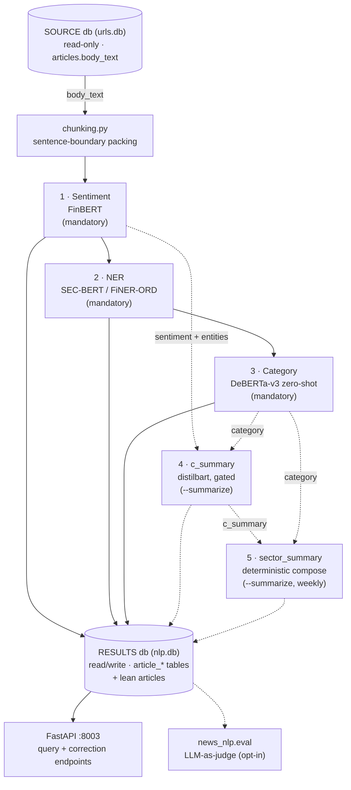

# Pipeline text superseded on 2026-11-10 (PLAN D39: the pipeline as the owner defined it)

Moved verbatim, IDs unchanged. Cut from the branch `feat/sentiment-pair-trainer` at the merge of master (`ba61e6b`).
The replacement text is `PLAN.md` D39 and the entries named in each section.

## PLAN.md D25 (replaced by D39)

- **D25 Order of the stages.** (1) the scope of the body; (2) NER, only for `single` and `multi`
  bodies; (3) a summary of every `single`, `sector`, `market_economy` and `investing_general` body (not `multi`, not `unrelated`); (4) for a `multi` body, the text each
  mentioned company gets; (5) sentiment, and the D15 category (D29), over the texts of steps 3 and 4;
  (6) company snapshots; (7) sector snapshots. `unrelated` stops at step 1 (D16). NER no longer
  runs on every body: sector, market / economy and `investing_general` bodies skip it.

## TASKS.md T-148 (P4; replaced by T-162 to T-168)

- [ ] **T-148** *(P4)* Texts, sentiment and category per (body, company), steps 3-5 of D25; each
      sub-task its own PR and its own FR when it ships. Single-company bodies use the whole summary;
      a dominated body (D23) is single + mentions; **the per-company category is accepted at >= 80%
      agreement with the owner's held-out gold (D24, confirmed)**. → P4.

## TASKS.md T-149 (P5; kept in a shorter form, sector path of D39 step 4)

- [ ] **T-149** *(P5)* Sector detection (GICS sector + sub-industry) for sector bodies;
      summaries of sector, market, economy and `investing_general` bodies feeding `sector_summary`,
      with `MARKET` / `ECONOMY` rows; **sector sub-industry detection accepted at >= 80% agreement
      with the owner's held-out gold (D24)**; its own FR. → P5.

## SPEC.md FR-001 (sentence about the new pipeline; the row stays, with a pointer to FR-020)

| **FR-001** | The sentiment stage runs `gamug/FinBERT-financial-news` (a continued fine-tune of `ProsusAI/finbert`, selected 2026-09-13 — §13 item 1) over every pending article's `body_text` (chunked, entity-scoped weighted average across chunks — full weight for chunks naming the article's own `company`/`ticker`, a lower baseline otherwise) and writes exactly one `article_sentiment` row per article. **Superseded for the new pipeline 2026-11-05 (PLAN D25/D26, T-148c): sentiment will read the summary or the company text, not the body, with no subject weighting; this FR describes the v1 tables until the backfill (T-150).** | After a pipeline run, every article with SOURCE text has an `article_sentiment` row with `label ∈ {positive, negative, neutral}`, `score`/`positive`/`negative`/`neutral` ∈ `[0, 1]`, and `model_name`/`processed_at` populated. |

## SPEC.md FR-004 (same)

| **FR-004** | The `c_summary` stage (opt-in, `--summarize`) generates one abstractive summary per article (`sshleifer/distilbart-cnn-12-6`, hierarchical reduce over chunks) **only** for articles that already have a sentiment row **and** at least one entity scoring `> 0.8`, writing `article_summary`. **Superseded for the new pipeline 2026-11-05 (PLAN D25, T-148a): the summary becomes a required step for every `single`, `sector`, `market_economy` and `investing_general` body, made before and not after sentiment, with no entity gate; this FR describes the v1 stage until the backfill (T-150).** | A normal (non-`--summarize`) pipeline run leaves `article_summary` untouched; an article failing the gate never gets a row even under `--summarize`; `num_chunks ≥ 1`. |

## SPEC.md section 4 (the diagram and the reading of it; the v1 diagram stays as the code of today)

## 4. System Architecture

**Reading this diagram**: solid arrows are the mandatory chain every
downstream consumer can rely on (stages 1–3, always run); dashed arrows are
the opt-in path (stages 4–5, only under `--summarize`) and the evaluation
subsystem (runs independently, off the same RESULTS store). `run_pipeline`
(`src/pipeline.py`) executes stages 1→2→3 unconditionally, then 4→5 only if
`summarize=True`, inside one process/one connection, `ATTACH`ing SOURCE
read-only and detaching it in a `finally` block.

Full detail, with hover tooltips per component: [the repository
artifact](https://claude.ai/code/artifact/65e62819-28dd-495b-b6ec-64f9c1751235)
referenced from `CLAUDE.md`. System-level placement of this repo among the
other five: [the architecture
overview](https://claude.ai/code/artifact/d3865a63-2894-4e20-b38a-7e50cf0d4040).

## SPEC.md section 6, "Batch pipeline run" (v1; stays as the code of today)

## 6. Core Workflows

**Batch pipeline run** (`cli/news_nlp_cli.py` → `pipeline.run_pipeline`):

1. Open RESULTS (`$DATABASE_URL`/`--results-db`), `ATTACH` SOURCE
   (`$SOURCE_DATABASE_URL`/`--source-db`) read-only.
2. `init_schema` (create-if-missing + additive migrations), then
   `require_source_text` — fail fast if SOURCE has no usable text.
3. Run sentiment → NER → category, each bounded by `--limit` if given, each
   skipping rows already present in its result table.
4. If `--summarize`: run `c_summary` (gated per-article), then
   `sector_summary` (closed weeks only).
5. Detach SOURCE, close the connection, print completion.

## PLAN.md D38 (long form; a short form stays in PLAN.md)

- **D38 Common words and surnames are not companies in the counts (T-161, PR #155; follows D37 of #154).** 15 tickers had counts far too high (FRT, STT, UNP, BE, XYZ, ...). **Cause:** the text matcher `CompanyResolver` (not the NER model, decision (k)): first-word aliases ("Federal", "Bloom") and one-word names ("Block"); retraining the NER would not change them. **Owner, 2026-11-09:** fold the other aliases into #155; CSV re-run after #155; redraw the gold pool and marks after the last matcher PR.
  **Change (built; the owner decides by merging):** (1) a hyphen, dash or apostrophe in a name reads as the space it replaced, a line break does not; (2) `_COMMON_FIRST_WORDS` join `_ALIAS_STOP`; (3) short forms and `_KNOWN_NAMES` count in themselves; (4) `_CORROBORATED` count only with another form of the company in the body, in `resolve` and `GuardedResolver` (`firm_spans`); (5) `_WORD_NAMES` capitalised only; (6) `_WORD_TICKERS` only with an explicit form; (7) stored NER spans obey the same rule; (8) names with upper-case initials, "!" and accents are found (AOS, CHRW, DHI, JBHT, SJM, TROW, USB, WRB, YUM, EL).
  **Measured** (everything, with the label file, in `docs/matcher_measurements_2026-11-09.md`): pairs 12,352 to 9,807 on a sample of 4,001 bodies (FRT 579 to 0, BE 97 to 2); precision of what is kept 94-97% by rule, the first-word alias rule 63% before the last edit and 88% on a sample no edit was chosen from; scope agreement on the 720: 0.696 to 0.700. **The disclosure column** `*_bodies_disclosure` (owner's decision (a)): 11.7-12.9% of the counted pairs, a reading by patterns (on a clean sample 40 of 40 flagged were disclosures, about 1 in 10 missed); `subject` and `single` not adjusted (5.2-7.3%, 0.3-0.7%).
  **The scope moves (round 8):** on the backtest window 5.6% of bodies change rule scope, 12.5% their subject companies, 1.0% enter the set that gets a summary and 0.3% leave it; on every `ok` body single +3.8 points, single + mentions -3.0. Figures documented with the old matcher (`docs/evaluation.md` sizing table, the held-out `frame` weights, T-148a) are marked "matcher at 786766f", not recomputed; the held-out gold keeps its strata. **The cut:** see (e).
  **Decided (owner, 2026-11-09, second session):** (a) the separate column; (b) the ten names fixed in #155; (c) no more list edits; (d) the attribution checkpoint `data/models/attribution_2026_11_08` (unpublished; old masks) is retrained after the CSV run and T-153; (e) **the cut is frozen as built** (manifest rules `f0a251aaf437`; reading it does not check them; the ~290 bodies the new rules would summarise get none); (f) #155 is not merged yet: one more review round. **Open:** USB, MSCI, ICE, MPC, DRI are tickers or acronyms, mixed; the CSV (T-160) is re-run after #155, before T-153 (D36 (j)).

**Owner answers for P2/P3 (2026-10-29), folded into D18/D20 above. No question is open.**
- *Q1* gate on a fixed 240 of the 720, at most 5 iterations; *Q2* point estimate with interval; *Q3*
  the held-out gold is drawn once before any training and excluded from every active-learning round
  (its tags are training data never); the one exception is Q4's second pass on about 50 of its
  bodies, which measures the label ceiling and is not used for training; *Q4* the owner re-tags all
  720 under the new taxonomy with the tags v1 shown as guidance: gold v2, not an independent
  consistency measure, so the ceiling is measured on the ~50 held-out bodies tagged twice a week
  apart (the owner agrees when they are drawn); order: labelling spec v2, re-tag file, then the
  gate on gold v2; the rules' 0.70 is re-measured on gold v2; *Q5* if the classifier stalls below
  its target the work stops and the owner decides; no LLM is added to the pipeline (D12).
- **Answered 2026-10-29.** *Q6 sampling frame:* custom rules prefilter the candidates for each rare
  scope (sector, market / economy, unrelated, `investing_general`), and the owner verifies a sample of
  **50 prefiltered articles** by hand before the held-out gold is drawn from them. Caveat recorded:
  the 50 check the filter's precision; its recall (rare-scope bodies the filter misses) stays
  unmeasured unless a random check sample is also read, and the inverse-sampling-fraction weights are
  valid only for strata defined before the draw, so rare-scope recall figures from this gold are
  conditional on the filter. *Q7 rounds:* **2 active-learning rounds** (about 300 bodies each) before
  the owner is asked again; owner effort about 1,070 bodies before round 1 plus about 600. *Q8 silver
  beyond scope:* per-company category and sub-industry silver labels are bought only at **>= 80%
  agreement with gold v2 on the 240** (the D24 bar); below it silver stays scope-only. *Q9 filter
  misses:* the held-out gold adds **~60 bodies drawn at random from outside the prefilter**, weighted
  by inverse sampling fraction, so per-scope recall (D20) includes what the filter misses; these
  are a third set of bodies, separate from the 50-article filter check and the 50 double-tagged.
  *Q10 calls per body:* **one call per body**; the reply lists every company with its D15 label, so
  the 240-call iteration and the 4,320 ceiling hold. Owner tagging tally: 720 re-tag + ~300
  held-out + ~60 misses + 50 filter check + 50 double-tag = about 1,180 bodies before round 1
  (the heavier tagging: scope, companies, D15 label per company, sub-industry), then 2 x ~300.

**Approach** (one PR per phase; each new table is proposed to the owner in the PR that needs it):

1. **P1 — foundations and sizing (T-144, T-145).** A read-only script counts unique bodies and
   resolves the companies each one names (name and explicit ticker forms, NER `ORG` spans matched
   to universe names; the upstream alias table of T-132 when it arrives), then gives rule-based scope
   candidates and a GICS guess, and scores the rules against the owner's 720 tagged articles. No
   spend, no schema change.
2. **P2 — labels (T-146).** Labelling spec v2, the revised prompt, the D18 silver labels and the
   owner's ~300 gold bodies.
3. **P3 — triage stage (T-147).** On unique bodies: the scope first (single company,
   several companies, sector, market / economy, `investing_general`, `unrelated`) from a local classifier (a fine-tuned
   small encoder over the text, the P1 rule features as inputs) trained on silver and gold, with
   active-learning rounds on its low-confidence bodies (D21) until it reaches >= 90% on the
   held-out gold (D20). Sketch of the tables: a body table keyed by body hash with its member pairs, and a
   per-body triage row (scope, companies, confidence). NER then runs on `single` and `multi`
   bodies only (D25).
4. **P4 — texts, sentiment and category (T-148).** The summary of every non-multi body (the pinned
   local summariser, step 3); for a multi body, the text of each company (step 4, D27: the
   one-segment-per-company parser, then the trained attribution model); then sentiment and the D15
   category over those texts (D26, D29), with the 180-text sentiment gold.
5. **P5 — sector, market and economy news, and the snapshots (T-149, T-152).** GICS sector /
   sub-industry detection, summaries of those bodies into `sector_summary` with `MARKET` /
   `ECONOMY` rows, and the company and sector snapshot tables (D28).
6. **P6 — backfill and close-out (T-150).** Re-process the stored corpus, update the
   knowledge-graph export contract, close Work items 15, 17 and 18 into `CHANGELOG.md`.

**Acceptance.** Every body has a scope, which agrees with the owner's held-out gold on >= 90% of
bodies (corpus-weighted point estimate, interval reported) and reaches recall >= 80% in each of the six
scopes (point estimate, interval reported; the floor applies to a scope with at least 40 gold bodies, D20 as amended by D33), measured with the
complete metric set (AI #12); the per-company category (P4) and the sector sub-industry (P5) each agree
with the held-out gold on >= 80% (D24, confirmed); no multi-company, sector, market or economy body is labelled `other`;
per-company sentiment and category exist for every company a body is about, computed on its
summary or company text (D26); company and sector snapshots exist, one row per body (D28); `sector_summary`
carries sector articles and `MARKET` / `ECONOMY` rows; the knowledge-graph export is updated and
documented; SPEC gains one FR per behaviour shipped.

## TASKS.md T-153 (long form; a short form stays)

- [ ] **T-153** *(coordination)* Reply to `portfolio-financial-analysis` (`to_nlp_backtest.md`, their 8
      questions): the training-data facts (about 30% of the sentences and bodies are from 2022 on, the
      labels have no date cut-off, nothing limits hindsight), what is decided (D31, D34) and what is not, their question 4 (which bodies count: the `role` column
      separates analysed from mention-only, D23), question 6 (running the pipeline on a SOURCE they provide: not yet; the cut covers the stored corpus, which ends 2026-08-12, and the bodies they add are not in it), question 8 (the agreement figures travel with the output and are in `PLAN.md` D32), `pub_date` formats (24 and 20 characters and empty, UTC not yet checked),
      the backtest cut (T-154: provisional, delivered about 2026-11-16 if the 2026-11-12 go/no-go holds) and the latest date their runs can use, and the final tables once T-152 is approved. Written for the owner's approval; nothing is sent. **Owner, 2026-11-09: sent after the company CSV run of T-160 (PR #152)**, so the reply carries the per-company counts and the coverage of the preserved corpus (D36 (j)). **Proposed, not decided (manager's review of #153):** if the company CSV is not done by the proposed date 2026-11-11 (the day before the 2026-11-12 go/no-go; the owner sets it), the owner decides whether to send the reply without it and say the per-company counts follow. When the owner answers, this line is replaced by the decision and its date.

## TASKS.md T-146e (end of the entry, the original plan)

        any training. *As drawn (D30): all 39 bodies the rules call no-company, sector, market or economy,
        the rest a seeded random draw from the 1,000-body sample; the original plan below (candidates
        prefiltered by custom rules, 50 of them checked by the owner first (Q6), ~60 random bodies from
        outside the filter (Q9), about 50 held-out bodies tagged twice (Q4)) is not what was drawn.*

