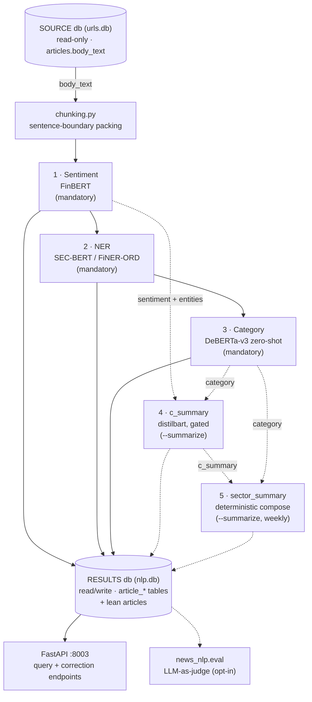

# Pipeline text superseded on 2026-11-10 (PLAN D39: the pipeline as the owner defined it)

Moved verbatim, IDs unchanged. Cut from the branch `feat/sentiment-pair-trainer` at the merge of master (`ba61e6b`).
The replacement text is `PLAN.md` D39 and the entries named in each section.

## PLAN.md D25 (replaced by D39)

- **D25 Order of the stages.** (1) the scope of the body; (2) NER, only for `single` and `multi`
  bodies; (3) a summary of every `single`, `sector`, `market_economy` and `investing_general` body (not `multi`, not `unrelated`); (4) for a `multi` body, the text each
  mentioned company gets; (5) sentiment, and the D15 category (D29), over the texts of steps 3 and 4;
  (6) company snapshots; (7) sector snapshots. `unrelated` stops at step 1 (D16). NER no longer
  runs on every body: sector, market / economy and `investing_general` bodies skip it.

## TASKS.md T-148 (P4; replaced by T-162 to T-168)

- [ ] **T-148** *(P4)* Texts, sentiment and category per (body, company), steps 3-5 of D25; each
      sub-task its own PR and its own FR when it ships. Single-company bodies use the whole summary;
      a dominated body (D23) is single + mentions; **the per-company category is accepted at >= 80%
      agreement with the owner's held-out gold (D24, confirmed)**. → P4.

## TASKS.md T-149 (P5; kept in a shorter form, sector path of D39 step 4)

- [ ] **T-149** *(P5)* Sector detection (GICS sector + sub-industry) for sector bodies;
      summaries of sector, market, economy and `investing_general` bodies feeding `sector_summary`,
      with `MARKET` / `ECONOMY` rows; **sector sub-industry detection accepted at >= 80% agreement
      with the owner's held-out gold (D24)**; its own FR. → P5.

## SPEC.md FR-001 (sentence about the new pipeline; the row stays, with a pointer to FR-020)

| **FR-001** | The sentiment stage runs `gamug/FinBERT-financial-news` (a continued fine-tune of `ProsusAI/finbert`, selected 2026-09-13 — §13 item 1) over every pending article's `body_text` (chunked, entity-scoped weighted average across chunks — full weight for chunks naming the article's own `company`/`ticker`, a lower baseline otherwise) and writes exactly one `article_sentiment` row per article. **Superseded for the new pipeline 2026-11-05 (PLAN D25/D26, T-148c): sentiment will read the summary or the company text, not the body, with no subject weighting; this FR describes the v1 tables until the backfill (T-150).** | After a pipeline run, every article with SOURCE text has an `article_sentiment` row with `label ∈ {positive, negative, neutral}`, `score`/`positive`/`negative`/`neutral` ∈ `[0, 1]`, and `model_name`/`processed_at` populated. |

## SPEC.md FR-004 (same)

| **FR-004** | The `c_summary` stage (opt-in, `--summarize`) generates one abstractive summary per article (`sshleifer/distilbart-cnn-12-6`, hierarchical reduce over chunks) **only** for articles that already have a sentiment row **and** at least one entity scoring `> 0.8`, writing `article_summary`. **Superseded for the new pipeline 2026-11-05 (PLAN D25, T-148a): the summary becomes a required step for every `single`, `sector`, `market_economy` and `investing_general` body, made before and not after sentiment, with no entity gate; this FR describes the v1 stage until the backfill (T-150).** | A normal (non-`--summarize`) pipeline run leaves `article_summary` untouched; an article failing the gate never gets a row even under `--summarize`; `num_chunks ≥ 1`. |

## SPEC.md section 4 (the diagram and the reading of it; the v1 diagram stays as the code of today)

## 4. System Architecture



**Reading this diagram**: solid arrows are the mandatory chain every
downstream consumer can rely on (stages 1–3, always run); dashed arrows are
the opt-in path (stages 4–5, only under `--summarize`) and the evaluation
subsystem (runs independently, off the same RESULTS store). `run_pipeline`
(`src/pipeline.py`) executes stages 1→2→3 unconditionally, then 4→5 only if
`summarize=True`, inside one process/one connection, `ATTACH`ing SOURCE
read-only and detaching it in a `finally` block.

Full detail, with hover tooltips per component: [the repository
artifact](https://claude.ai/code/artifact/65e62819-28dd-495b-b6ec-64f9c1751235)
referenced from `CLAUDE.md`. System-level placement of this repo among the
other five: [the architecture
overview](https://claude.ai/code/artifact/d3865a63-2894-4e20-b38a-7e50cf0d4040).


## SPEC.md section 6, "Batch pipeline run" (v1; stays as the code of today)

## 6. Core Workflows

**Batch pipeline run** (`cli/news_nlp_cli.py` → `pipeline.run_pipeline`):

1. Open RESULTS (`$DATABASE_URL`/`--results-db`), `ATTACH` SOURCE
   (`$SOURCE_DATABASE_URL`/`--source-db`) read-only.
2. `init_schema` (create-if-missing + additive migrations), then
   `require_source_text` — fail fast if SOURCE has no usable text.
3. Run sentiment → NER → category, each bounded by `--limit` if given, each
   skipping rows already present in its result table.
4. If `--summarize`: run `c_summary` (gated per-article), then
   `sector_summary` (closed weeks only).
5. Detach SOURCE, close the connection, print completion.


## PLAN.md D38 (long form; a short form stays in PLAN.md)

- **D38 Common words and surnames are not companies in the counts (T-161, PR #155; follows D37 of #154).** 15 tickers had counts far too high (FRT, STT, UNP, BE, XYZ, ...). **Cause:** the text matcher `CompanyResolver` (not the NER model, decision (k)): first-word aliases ("Federal", "Bloom") and one-word names ("Block"); retraining the NER would not change them. **Owner, 2026-11-09:** fold the other aliases into #155; CSV re-run after #155; redraw the gold pool and marks after the last matcher PR.
  **Change (built; the owner decides by merging):** (1) a hyphen, dash or apostrophe in a name reads as the space it replaced, a line break does not; (2) `_COMMON_FIRST_WORDS` join `_ALIAS_STOP`; (3) short forms and `_KNOWN_NAMES` count in themselves; (4) `_CORROBORATED` count only with another form of the company in the body, in `resolve` and `GuardedResolver` (`firm_spans`); (5) `_WORD_NAMES` capitalised only; (6) `_WORD_TICKERS` only with an explicit form; (7) stored NER spans obey the same rule; (8) names with upper-case initials, "!" and accents are found (AOS, CHRW, DHI, JBHT, SJM, TROW, USB, WRB, YUM, EL).
  **Measured** (everything, with the label file, in `docs/matcher_measurements_2026-11-09.md`): pairs 12,352 to 9,807 on a sample of 4,001 bodies (FRT 579 to 0, BE 97 to 2); precision of what is kept 94-97% by rule, the first-word alias rule 63% before the last edit and 88% on a sample no edit was chosen from; scope agreement on the 720: 0.696 to 0.700. **The disclosure column** `*_bodies_disclosure` (owner's decision (a)): 11.7-12.9% of the counted pairs, a reading by patterns (on a clean sample 40 of 40 flagged were disclosures, about 1 in 10 missed); `subject` and `single` not adjusted (5.2-7.3%, 0.3-0.7%).
  **The scope moves (round 8):** on the backtest window 5.6% of bodies change rule scope, 12.5% their subject companies, 1.0% enter the set that gets a summary and 0.3% leave it; on every `ok` body single +3.8 points, single + mentions -3.0. Figures documented with the old matcher (`docs/evaluation.md` sizing table, the held-out `frame` weights, T-148a) are marked "matcher at 786766f", not recomputed; the held-out gold keeps its strata. **The cut:** see (e).
  **Decided (owner, 2026-11-09, second session):** (a) the separate column; (b) the ten names fixed in #155; (c) no more list edits; (d) the attribution checkpoint `data/models/attribution_2026_11_08` (unpublished; old masks) is retrained after the CSV run and T-153; (e) **the cut is frozen as built** (manifest rules `f0a251aaf437`; reading it does not check them; the ~290 bodies the new rules would summarise get none); (f) #155 is not merged yet: one more review round. **Open:** USB, MSCI, ICE, MPC, DRI are tickers or acronyms, mixed; the CSV (T-160) is re-run after #155, before T-153 (D36 (j)).

**Owner answers for P2/P3 (2026-10-29), folded into D18/D20 above. No question is open.**
- *Q1* gate on a fixed 240 of the 720, at most 5 iterations; *Q2* point estimate with interval; *Q3*
  the held-out gold is drawn once before any training and excluded from every active-learning round
  (its tags are training data never); the one exception is Q4's second pass on about 50 of its
  bodies, which measures the label ceiling and is not used for training; *Q4* the owner re-tags all
  720 under the new taxonomy with the tags v1 shown as guidance: gold v2, not an independent
  consistency measure, so the ceiling is measured on the ~50 held-out bodies tagged twice a week
  apart (the owner agrees when they are drawn); order: labelling spec v2, re-tag file, then the
  gate on gold v2; the rules' 0.70 is re-measured on gold v2; *Q5* if the classifier stalls below
  its target the work stops and the owner decides; no LLM is added to the pipeline (D12).
- **Answered 2026-10-29.** *Q6 sampling frame:* custom rules prefilter the candidates for each rare
  scope (sector, market / economy, unrelated, `investing_general`), and the owner verifies a sample of
  **50 prefiltered articles** by hand before the held-out gold is drawn from them. Caveat recorded:
  the 50 check the filter's precision; its recall (rare-scope bodies the filter misses) stays
  unmeasured unless a random check sample is also read, and the inverse-sampling-fraction weights are
  valid only for strata defined before the draw, so rare-scope recall figures from this gold are
  conditional on the filter. *Q7 rounds:* **2 active-learning rounds** (about 300 bodies each) before
  the owner is asked again; owner effort about 1,070 bodies before round 1 plus about 600. *Q8 silver
  beyond scope:* per-company category and sub-industry silver labels are bought only at **>= 80%
  agreement with gold v2 on the 240** (the D24 bar); below it silver stays scope-only. *Q9 filter
  misses:* the held-out gold adds **~60 bodies drawn at random from outside the prefilter**, weighted
  by inverse sampling fraction, so per-scope recall (D20) includes what the filter misses; these
  are a third set of bodies, separate from the 50-article filter check and the 50 double-tagged.
  *Q10 calls per body:* **one call per body**; the reply lists every company with its D15 label, so
  the 240-call iteration and the 4,320 ceiling hold. Owner tagging tally: 720 re-tag + ~300
  held-out + ~60 misses + 50 filter check + 50 double-tag = about 1,180 bodies before round 1
  (the heavier tagging: scope, companies, D15 label per company, sub-industry), then 2 x ~300.

**Approach** (one PR per phase; each new table is proposed to the owner in the PR that needs it):

1. **P1 — foundations and sizing (T-144, T-145).** A read-only script counts unique bodies and
   resolves the companies each one names (name and explicit ticker forms, NER `ORG` spans matched
   to universe names; the upstream alias table of T-132 when it arrives), then gives rule-based scope
   candidates and a GICS guess, and scores the rules against the owner's 720 tagged articles. No
   spend, no schema change.
2. **P2 — labels (T-146).** Labelling spec v2, the revised prompt, the D18 silver labels and the
   owner's ~300 gold bodies.
3. **P3 — triage stage (T-147).** On unique bodies: the scope first (single company,
   several companies, sector, market / economy, `investing_general`, `unrelated`) from a local classifier (a fine-tuned
   small encoder over the text, the P1 rule features as inputs) trained on silver and gold, with
   active-learning rounds on its low-confidence bodies (D21) until it reaches >= 90% on the
   held-out gold (D20). Sketch of the tables: a body table keyed by body hash with its member pairs, and a
   per-body triage row (scope, companies, confidence). NER then runs on `single` and `multi`
   bodies only (D25).
4. **P4 — texts, sentiment and category (T-148).** The summary of every non-multi body (the pinned
   local summariser, step 3); for a multi body, the text of each company (step 4, D27: the
   one-segment-per-company parser, then the trained attribution model); then sentiment and the D15
   category over those texts (D26, D29), with the 180-text sentiment gold.
5. **P5 — sector, market and economy news, and the snapshots (T-149, T-152).** GICS sector /
   sub-industry detection, summaries of those bodies into `sector_summary` with `MARKET` /
   `ECONOMY` rows, and the company and sector snapshot tables (D28).
6. **P6 — backfill and close-out (T-150).** Re-process the stored corpus, update the
   knowledge-graph export contract, close Work items 15, 17 and 18 into `CHANGELOG.md`.

**Acceptance.** Every body has a scope, which agrees with the owner's held-out gold on >= 90% of
bodies (corpus-weighted point estimate, interval reported) and reaches recall >= 80% in each of the six
scopes (point estimate, interval reported; the floor applies to a scope with at least 40 gold bodies, D20 as amended by D33), measured with the
complete metric set (AI #12); the per-company category (P4) and the sector sub-industry (P5) each agree
with the held-out gold on >= 80% (D24, confirmed); no multi-company, sector, market or economy body is labelled `other`;
per-company sentiment and category exist for every company a body is about, computed on its
summary or company text (D26); company and sector snapshots exist, one row per body (D28); `sector_summary`
carries sector articles and `MARKET` / `ECONOMY` rows; the knowledge-graph export is updated and
documented; SPEC gains one FR per behaviour shipped.

## TASKS.md T-153 (long form; a short form stays)

- [ ] **T-153** *(coordination)* Reply to `portfolio-financial-analysis` (`to_nlp_backtest.md`, their 8
      questions): the training-data facts (about 30% of the sentences and bodies are from 2022 on, the
      labels have no date cut-off, nothing limits hindsight), what is decided (D31, D34) and what is not, their question 4 (which bodies count: the `role` column
      separates analysed from mention-only, D23), question 6 (running the pipeline on a SOURCE they provide: not yet; the cut covers the stored corpus, which ends 2026-08-12, and the bodies they add are not in it), question 8 (the agreement figures travel with the output and are in `PLAN.md` D32), `pub_date` formats (24 and 20 characters and empty, UTC not yet checked),
      the backtest cut (T-154: provisional, delivered about 2026-11-16 if the 2026-11-12 go/no-go holds) and the latest date their runs can use, and the final tables once T-152 is approved. Written for the owner's approval; nothing is sent. **Owner, 2026-11-09: sent after the company CSV run of T-160 (PR #152)**, so the reply carries the per-company counts and the coverage of the preserved corpus (D36 (j)). **Proposed, not decided (manager's review of #153):** if the company CSV is not done by the proposed date 2026-11-11 (the day before the 2026-11-12 go/no-go; the owner sets it), the owner decides whether to send the reply without it and say the per-company counts follow. When the owner answers, this line is replaced by the decision and its date.


## TASKS.md T-146e (end of the entry, the original plan)

        any training. *As drawn (D30): all 39 bodies the rules call no-company, sector, market or economy,
        the rest a seeded random draw from the 1,000-body sample; the original plan below (candidates
        prefiltered by custom rules, 50 of them checked by the owner first (Q6), ~60 random bodies from
        outside the filter (Q9), about 50 held-out bodies tagged twice (Q4)) is not what was drawn.*


## Out of the MVP (market, economy, investing_general, unrelated; D39)

PLAN.md D14 clause: market and economy news become `MARKET` / `ECONOMY` rows there;

PLAN.md D22 clause: D22 six scopes (the MVP handles three, D39): single company, several companies, sector, market / economy,
`investing_general` (investing or market-advice content about no company and no sector, the owner's
`other` tag: no per-company analysis, summarised in the `MARKET` row of `sector_summary`) and `unrelated`;

TASKS.md T-146e1 (verbatim):

      - [ ] **T-146e1** Prefilter rules for sector / market-economy / unrelated / `investing_general`
        (tests; measured on gold v2); the same candidates feed T-146d's oversampling.


## Out of the MVP, second cut (owner 2026-11-10): ops and test hygiene; the replaced attribution model and the LLM silver labelling

### TASKS.md entries, verbatim

- [ ] **T-022** *(maintainer)* Decide whether a bulk re-extraction of the
      remaining ~439,000 pre-fix `article_entities_v1` articles (not
      resampled by T-025) is worth doing — the fix is future-runs-only by
      design (`docs/evaluation.md` 2026-09-10 follow-up, "Scope"). No
      longer blocking T-020 (T-025 unblocked it with a smaller sample);
      this is now purely about full-corpus coverage. → step 3.

- [ ] **T-032** Re-solve `docs/evaluation.md`'s "Sample-size floor" purity
      estimates using T-031's actual measured per-stratum agreement
      (`strata_json` / `agreement_rate_target_negative` etc.) instead of
      today's planning-only estimates, before locking in a permanent
      `--sample-size` default. → step 3. **Still open** — not done as
      part of the 2026-09-13 fine-tuning work; the four real evals give
      more empirical grounding than before but the purity-estimate
      re-solve itself hasn't been done.

- [ ] **T-062** Tune `NER_BATCH_SIZE` empirically against the 6GB VRAM
      budget (SPEC.md NR-001) and measure the real throughput improvement
      (articles/sec) on a real sample (mirrors T-025's resample as a
      before/after comparison) — don't assume batching helps without
      measuring it, and don't copy `CATEGORY_BATCH_SIZE`/
      `SUMMARY_BATCH_SIZE`'s values blind (NER's per-chunk sequence
      length and variable chunks-per-article shape a different memory
      profile). **Not done — needs the project's actual GPU**, which the
      environment T-060/T-061 shipped from doesn't have (CPU-only
      sandbox); `NER_BATCH_SIZE=8` is an untested starting guess, not a
      measured value. → steps 5, 7.

- [ ] **T-156** *(test hygiene, 2026-11-06)* Flaky test `tests/news_nlp/test_eval_calibration_judge.py::test_an_interrupt_cancels_the_queue_instead_of_paying_for_it`: failed once in CI (PR #129, `assert 4 <= 3`), passed on the next run. It counts calls made by worker threads against a 0.05 s sleep, so the bound depends on timing. Fix: bound by the number of workers plus one, or stop the queue with an event instead of a sleep.

- [ ] **T-157** *(Windows, T-148a, 2026-11-07; PR #134, `docs/db-topology.md`)* The summaries cut's run lock probed a pid with `os.kill(pid, 0)`, which terminates on Windows. **Done:** the probe uses `OpenProcess` + `WaitForSingleObject`; the lock holds the pid and the process start time; Ctrl-Break stops like Ctrl-C; a `win32`-only test. Decision: no Windows CI job. **Closes when** the owner has resumed the cut once on Windows with a leftover lock and got no refusal. **Open:** taking over a stale lock is not atomic (chunk files are, so only work is duplicated); a lock of this version reads as stale to an older script; closing the console window cannot be caught. → T-148a. Full text before 2026-11-08: `.specify/memory/archive/TASKS-open-entries-2026-11-08.md` § T-157.

- [ ] **T-148b2** Training set for the attribution model from the structured bodies (company name masked, previous sentence as context, all years). **Built** (`scripts/build_company_segments_2026_11_05.py`, `gold/company_segments_train.csv`, ids and positions only): 2,834 bodies, 33,624 segments (21,682 `lead`, 11,942 `continuation`), 1 body in 10 as `val` (205 before 2022, 65 from 2022 on, reported apart); the 33 bodies that share text with a tagged or held-out article are left out; `tests/news_nlp/test_company_texts.py` pins the parser constants and counts. Built 2026-11-06: the mention-and-recency baseline (`news_nlp.attribution_baseline`) and the label check (100 `lead` + 100 `continuation`, `gold/segment_check_gold.csv`).
      - **Rule fixed before the check (owner, 2026-11-06):** `continuation` is dropped from training if at most 80% are right. **Read:** `lead` 88.0% [80.2, 93.0], `continuation` 38.0% [29.1, 47.8], so the model trains on `lead` only (PLAN D27). Acceptance (D32): at least 80% of the companies named in the faithfulness bodies with a faithful text, and better than the baseline on the same bodies; read in T-148b10. → D27, D32. Full text before 2026-11-08: `.specify/memory/archive/TASKS-open-entries-2026-11-08.md` § T-148b2.

- [ ] **T-148b3** *(trained model, merged, #141; **not published, not pinned**)* The trained attribution model (`src/news_nlp/attribution_model.py`, `scripts/train_attribution_2026_11_08.py`, `CompanyResolver.mention_spans`, `draw_faithfulness --attribution-model`). Trains on `lead` rows only (D27, label check 2026-11-06; the run refuses to start unless `gold_metrics.train_on_lead_only` is true); bodies it cannot attribute are flagged `unextracted`, never given a default text.
      - **Left (owner's word):** publish, the pin in `config/pipeline_models.json` under `attribution` with its revision, the `ExperimentSpec` stage. The model behind every `units` figure is the local directory `data/models/attribution_2026_11_08` (`local:8399ccf003c60143`).
      - **Open question (proposed, not decided):** the model has not learned to answer "none of these": a sentence about a company outside the universe goes to the nearest one (wrong cases scored 0.9 or more, so a higher threshold does not help; (c) is not supported). Options: (a) retrain with negatives that belong to nobody; (b) measure again after the stricter cuts of #143 and #144. One-word names (`JPMorgan`) are not read by the resolver (T-148b7). → D27. Full text before 2026-11-08: `.specify/memory/archive/TASKS-open-entries-2026-11-08.md` § T-148b3.

- [ ] **T-148b7** *(owner's decision 2026-11-07)* Person names and common words ("home", "union") that the guard does not stop: an item of its own, **after the cut** (not before it), to be measured against the owner's next tagging round. Nothing is built for it now.

- [ ] **T-146c** Revised LLM labelling prompt and gate: iterate on a fixed stratified 240 of gold v2 (at most 5 iterations, about 240 calls each), then the full 720 (480 new calls) at >= 90% scope agreement. Silver D15 labels and sub-industries are bought in P2 only if a second gate on the 240 (per-company category and sub-industry agreement with gold v2, >= 80%) passes; otherwise silver is scope-only. Budget: silver <= 6,000 - 240k - 480 for k iterations; judge repairs count against the 6,000.
      - The 240 is drawn once by `scripts/draw_gate240_2026_11_04.py` (quotas in `retag.GATE_QUOTAS`; local `data/gate240_ids.csv`); the owner tags it in `data/gate240_to_tag.csv`. The tracked gold files are `gold/category_gold_v2.csv` (240 + 44 sector) and `gold/category_gold_v2_test.csv` (200 held-out, #142), built by `scripts/build_gold_2026_11_05.py`; the article text stays out of git. Workflow: `docs/labelling-spec-v2.md`, "The fixed 240 of the prompt gate".
      - Owner calls 2026-11-05: company labels on sector/market_economy/investing_general bodies, several labels per company, `sub_industry` as GICS codes of any level; 44 more sector-like bodies were drawn for the sub-industry gate. → P2, D18. Full text before 2026-11-08: `.specify/memory/archive/TASKS-open-entries-2026-11-08.md` § T-146c.

      - [ ] **T-146d** Silver: at most 4,320 bodies, bought only after T-146c passes, oversampling
        the candidates for the rare scopes.
      - T-146e1 (prefilter rules for market, economy, unrelated, `investing_general`): out of the MVP, D39 (`archive/PIPELINE-superseded-2026-11-10.md`).

## Work item 2 — Make the regression gate runnable (ops, blocked on maintainer)

- [ ] **T-010** *(maintainer)* Designate/stand up a machine with durable
      access to `$SOURCE_DATABASE_URL`/`$DATABASE_URL` and a persistent
      `mlruns` dir or MLflow server. → `PLAN.md` Work item 2, step 1.
- [ ] **T-011** *(maintainer)* Register it as a GitHub self-hosted runner
      labeled `thesis-data`. → step 2.
- [ ] **T-012** *(maintainer)* Add repo secrets: `LLM_API_KEY`,
      `LLM_MODEL`, `LLM_URL`, `MLFLOW_TRACKING_URI`,
      `SOURCE_DATABASE_URL`, `DATABASE_URL`. → step 3.
- [ ] **T-013** Edit `.github/workflows/eval.yml`: uncomment
      `runs-on: [self-hosted, thesis-data]`, remove the
      `runs-on: ubuntu-latest` placeholder. → step 4. (Code change, but
      meaningless without T-010–T-012 done first — don't land this alone
      expecting it to work.)
- [ ] **T-014** *(maintainer)* Trigger `workflow_dispatch` once; confirm a
      real MLflow run + `eval_run` row is produced. → step 5 / first
      acceptance criterion.
- [ ] **T-015** *(maintainer)* Confirm the gate actually gates: induce a
      regression (temporarily lowered `--regression-tolerance`, or a
      second run compared against a known-worse one) and confirm the
      workflow fails. → second acceptance criterion.
- [ ] **T-016** Update `SPEC.md` §13 item 8 to reflect the resolved (or
      deliberately re-scoped) state. → third acceptance criterion. Also
      update the two architecture artifacts per constitution AI behavior
      #11 — reconcile, never rename.


### PLAN.md Work item 2, verbatim

## Work item 2 — Make the `--check-regression` gate runnable

**Why**: `.github/workflows/eval.yml` already invokes
`cli/news_nlp_eval.py … --check-regression` — the code-level gate
`SPEC.md` §13 item 8 was originally written as missing already exists.
What's actually missing is the *infrastructure* the workflow's own header
comment says it assumes and doesn't have: a self-hosted runner with
`$SOURCE_DATABASE_URL`/`$DATABASE_URL` mounted, a persistent
`$MLFLOW_TRACKING_URI` for `--check-regression` to have a prior run to
compare against, and the `LLM_API_KEY`/`LLM_MODEL`/`LLM_URL` repo secrets.
On the current `runs-on: ubuntu-latest`, the workflow has no data to run
against — it's a template, not a working gate, and its `schedule:` trigger
is presently running (or failing) against nothing.

**This is an operational task, not a code task** — constitution AI
behavior #10 ("ask before expanding scope") applies: standing up a
self-hosted runner and provisioning secrets is an infrastructure decision
for the repo owner to make and execute, not something to do
unilaterally inside a PR. This plan documents what's needed; a human
completes it.

**Steps** (for the repo owner/maintainer):

1. Stand up (or designate) a runner with persistent access to the working
   SOURCE/RESULTS SQLite files and a durable `mlruns` directory (or a real
   MLflow tracking server) — the same machine the manual
   `uv run cli/news_nlp_eval.py` invocations already run on is the
   simplest choice.
2. Register it as a GitHub self-hosted runner with (at least) the
   `thesis-data` label `eval.yml` already references in its commented-out
   `runs-on:` line.
3. Add the six repo secrets `eval.yml` reads:
   `LLM_API_KEY`, `LLM_MODEL`, `LLM_URL`, `MLFLOW_TRACKING_URI`,
   `SOURCE_DATABASE_URL`, `DATABASE_URL`.
4. Uncomment `runs-on: [self-hosted, thesis-data]` and remove/replace the
   `runs-on: ubuntu-latest` line beneath it.
5. Trigger once via `workflow_dispatch` to confirm the run completes,
   produces an `eval_run` row, and (on a second manual run) that
   `--check-regression` actually compares against the first.

**Acceptance criteria**:

- A `workflow_dispatch` run of `eval.yml` completes successfully on the
  designated runner and produces a real MLflow run + `eval_run` row.
- A deliberately-induced regression (e.g. temporarily lowering
  `--regression-tolerance` below a known noise level, or comparing against
  a run with a known worse metric) causes the workflow to fail — proving
  the gate actually gates, not just runs.
- `SPEC.md` §13 item 8 updated to reflect the new state (resolved, or
  re-scoped if the maintainer decides differently — e.g. keeping it
  scheduled-only rather than PR-blocking, which is a legitimate choice
  given the LLM cost of running this on every PR).


### PLAN.md D18, verbatim

D18 about 6,000 LLM labelling calls (a hard cap, logged in `docs/evaluation.md`, counted per
task, the run stops at it), the owner re-tags the 720 under the new taxonomy (v1 was tagged blind to the LLM label: the review file had no LLM column; the v2 file keeps it hidden and shows only the owner's v1 tag) (gold v2; the first tagging is "tags v1", a development
set), the revised prompt iterates on a fixed stratified 240 of them (at most 5 iterations) and must agree
with the owner's scope on >= 90% of the full 720 before silver is bought (at most 4,320 bodies: 6,000 minus
1,200 iteration calls minus 480 for the full pass; a 6th iteration is never spent without asking), and the
owner tags about 300 held-out gold bodies drawn across the corpus, at least 40 per scope (D30 drew 200 instead; D33: no top-up, and no recall floor for a scope under 40 gold bodies)

## Third cut (owner 2026-11-10): T-154, T-153, T-160, T-158, and T-155's long text

- [ ] **T-154** *(backtest cut, D34)* A provisional output for the bodies of the backtest window (published 2021-12-31 or later), about 2026-11-16: scope from the rules, NER for single and multi bodies, summaries (T-148a), company texts (T-148b, extractor `units`, T-148b10 (9)), sentiment over the texts (T-148c). Written as chunked files under `data/cut/` in the columns approved in T-152, resumable, no schema change; the stored corpus only (it ends 2026-08-12); marked provisional, with the measured figures (rules' scope agreement on the held-out 200, extractor faithfulness, sentiment agreement on the 180) next to it.
      - **Go/no-go 2026-11-12:** the owner's tagging (held-out 200, label check 200, faithfulness texts, sentiment 180) is done and the extractor passes D32; otherwise the backtest team is told with a week's notice. After a go: NER, step 4 and sentiment over the window 11-12 to 11-14, hand-over about 11-16.
      - **Rules fixed beforehand (owner, 2026-11-06, PLAN D34):** a sentiment figure whose interval straddles its bar ("not decided") still goes, with the interval printed; a faithfulness FAIL does not go. If the held-out 200 is not back, the scope figure is reported as "not evaluated" and the cut goes if the other three pass; the faithfulness and sentiment fallbacks are in T-148b10 and T-148c.
      - Not in the cut: the trained scope classifier, the prompt gate and silver labels, category, sub-industry, sector snapshots, active learning, the full backfill. → D34. Full text before 2026-11-08: `.specify/memory/archive/TASKS-open-entries-2026-11-08.md` § T-154.


- [ ] **T-153** *(coordination)* Reply to `portfolio-financial-analysis` (`to_nlp_backtest.md`, their 8 questions). **Owner, 2026-11-09: sent after the company CSV run of T-160 (PR #152).** Since 2026-11-10 the final tables follow the pipeline of D39 (T-162 to T-168, snapshots T-152): `to_nlp_backtest.md` is to be updated with them. Full text and the proposed dates: `archive/PIPELINE-superseded-2026-11-10.md`.

- [ ] **T-160** *(D36; the script is merged (#152), not yet run on the whole corpus)* **News per company, and what the preserved corpus would add.** CPU only, no model. **Deliverable (owner, 2026-11-09): a CSV for the owner's partner, one row per company of the whole S&P universe over every date of the corpus**, `company_news_counts_<date>.csv` plus a README of the same date (send both): per company, in three corpora (`ok`, `quarantined_only`, `all`), the unique bodies that **name** it, have it as a **subject** and have it as the **only** subject; names read from the text only (owner, 2026-11-09: no stored NER spans); no article text. `scripts/company_news_counts_2026_11_09.py`: `tqdm` bar, idempotent and resumable (checkpoint, `--fresh`), the counts checked against themselves and against T-159's (309,882 / 81,961 / 227,921), a lock file. **Time, not measured:** about 3 to 4 hours for the whole corpus (the size script took about 50 minutes for the 81,961 `ok` bodies). **The owner runs it on Windows:** `uv run scripts\company_news_counts_2026_11_09.py --limit 20000 --out data\company_news_counts_smoke` (smoke), then `uv run scripts\company_news_counts_2026_11_09.py`; if it stops, the same command continues. Open: the smoke run's counting time, the comparison with T-159 after the full run, the owner reading the CSV before it is sent, T-153 after it. It decides what the backfill after the delivery would process (D19, T-150) and what T-153 tells the backtest team. Full text before this condensation: `.specify/memory/archive/TASKS-open-entries-2026-11-08.md` § T-160. → D36.

- [ ] **T-158** *(manager's review of #147, 2026-11-08; proposed, not started)* Apply the status-decision-open-pointer shape to the long paragraphs of `PLAN.md` Work item 18 (D34 (a) to (d), D35's recipe, order of the end and GPU: lines of 2 to 4.4 KB), moving the history verbatim to `archive/`. The section is 53 KB of a 58 KB cap (`tests/test_memory_size.py`); one more round of decision notes would fill it. Not before the current decisions of Work item 18 settle.

- [ ] **T-155** *(gold sets, `docs/gold_datasets.md`)* Move the tagged sets from `data/` to `gold/` with builders that write marks and ids only (no news text), refuse unless every row is marked and valid, protect the tracked marks from silent change (`--overwrite-marks`), and let `report_wi18 ... --gold` reproduce the figures.
      - **Done:** label check (`build_segment_check_gold_2026_11_06.py`, 200 rows), extractor sample (`build_faithfulness_gold_2026_11_06.py`, 190 baseline rows + coverage), sentiment (`build_sentiment_gold_2026_11_06.py`, 180 rows, agreement 60.4% [52.8, 67.6]), held-out scope (#142, 200 rows, row hashes in `tests/news_nlp/heldout_gold_row_hashes.csv`).
      - **Left:** a typed reader per gold file in `news_nlp.retag` (today only the column tuples exist); where the only copy of the 180 texts (`data/sentiment_gold_ids.csv`) is kept (nothing enforces a backup); the extractor evidence of T-148b11 (the `units*` marks, the confirmation set, the exempt readings). → `docs/gold_datasets.md`, D31–D33. Full text before 2026-11-08: `.specify/memory/archive/TASKS-open-entries-2026-11-08.md` § T-155.

## Fourth cut (review of PR #160, owner 2026-11-10)

### PLAN D34 (the backtest cut), verbatim

- **D34 The backtest cut for the 2026-11-20 thesis delivery (T-154).** A short path, built while the
  full plan continues: for the bodies of the backtest window (published 2021-12-31 or later, about
  29,000 unique bodies), scope from the rules (not the classifier), NER for single and multi
  bodies, a summary of each non-multi body (measured 0.84 s per body on the local GPU, up to 7
  hours for the window), the step-4 company texts (D27), and sentiment over the texts checked on
  the 180-text gold (D32; the 60 extractor texts cover narrative multi bodies, and a row's
  `sentiment_checked` says whether its kind of text was in the gold, whose figures are weighted to the tagged-body pool, D32). **Output (owner, 2026-11-06):**
  files, not tables: chunks under `data/cut/` (git-ignored, they hold news text), one row per
  (body, company) with the approved columns of T-152, written chunk by chunk so a stopped run resumes
  from the last chunk; no schema change. **Coverage:** the stored corpus, which ends 2026-08-12; the
  backtest window runs to 2026-10-15, and the bodies the backtest team adds upstream are not in the
  cut. **Provisional**: the output says so and carries the measured figures; it
  is not the accepted pipeline. Left to after the delivery: the trained scope classifier and its
  90% bar, the prompt gate and the silver labels, category (D24) and sub-industry, sector
  snapshots, active learning, the full backfill, the knowledge-graph contract. **Go/no-go on
  2026-11-12**: if the owner's tagging (the held-out 200, 200 label-check paragraphs, the 30
  190 faithfulness texts (30 bodies; 2026-11-06 the draw gave 190, not the 30 assumed) and the 180 sentiment texts: 770 items, 200 of them marked) is done and the extractor passes D32 (**owner call 2026-11-06: tag all 190 faithfulness texts**),
  the data goes to the backtest team about 2026-11-16 (four days before delivery, which is tight
  for them: T-153 asks for the latest date they can use); otherwise they are told, with a week's
  notice, to report the layer as not evaluated. **Measured 2026-11-07 on the held-out 200 (T-146e, PR #142): the rules' scope agreement 68.0% [61.3, 74.5] weighted to the corpus (raw 59.5%); single recall 91.0% [87.1, 94.4] passes the 80% bar, multi recall 52.5% [42.8, 63.5] fails it; sector, market_economy, unrelated and investing_general have 9, 11, 8 and 7 gold bodies, so no recall floor applies (D33) and their recalls (2.6%, 12.1%, 0.0%, 0.0%) are disclosure, not rates. The cut uses the rules' scope (this decision); *proposed, not decided:* report these figures with the cut and leave the trained scope classifier (left to after the delivery) as the answer to the multi gap; the go/no-go is the owner's.** **Rules fixed beforehand (owner, 2026-11-06):**
  (a) a sentiment figure whose interval straddles its bar (D32 "not decided") does not stop the
  cut: it goes with the point estimate and the interval printed; **(owner, 2026-11-07: a figure that FAILS its bar, as overall sentiment agreement does since 2026-11-06, is answered by fine-tuning on summaries: D35; a figure whose interval then straddles the bar is "not decided" and this rule applies); **(owner, 2026-11-07, answered: an `undefined` bar, D32, is not "not decided" and this rule does not cover it: it counts as not passed, and the cut goes only with the sentiment layer marked as measured, as in D35's fallback, never as "not decided")** (b) if the attribution model is not
  ready on 2026-11-09, the faithfulness texts are exported from the baseline alone and the decision
  is on the baseline (**result 2026-11-06, 190 texts of the 30 bodies marked: baseline 60.5% faithful, interval 45.2 to 73.8, so it fails the 80% bar; 2022+ 60.6% [27.6, 86.1], not decided; of the texts it wrote 60.5% [53.4, 67.2]; no company was left without a text (`gold/faithfulness_coverage.csv` is empty), and `report_wi18 faithfulness --gold --out gold` reproduces these figures from the tracked files; one body of 21 texts has 4 faithful. Unless the model (T-148b3) passes, narrative multi bodies are left out of the cut and counted**): the cut uses it for narrative bodies if it is at least 80% faithful (D32 reading: of the companies named),
  otherwise narrative multi bodies are left out of the cut and counted; (c) the label check of
  D27 decides, before the model trains, whether the `continuation` labels are used; (d) a sentiment stratum with fewer texts than the draw takes is drawn whole (a census: held fixed in the bootstrap and marked in the report), the others do not change, and the cut still goes (D32); the scored pool is kept with the extractor, tagged bodies and model revisions it was made under, and a draw under other conditions stops; **(e) Selection of step 4's extractor (owner, 2026-11-08): `units` ("units1") is the base model**, because the accuracy does not need to be above 80% and it clears it: on the confirmation set 86.1% [80.9, 90.7] on every company named (pass) and 95.3% [92.0, 98.2] on real companies; on the first set (development) 94.0% [87.0, 99.2] on real companies (pass) and 83.2% [72.7, 91.0] on every company named (not decided). It is level with the baseline (gain -0.5 [-1.5, 0.0], not decided), so the proposed rule T-148b10 (6b) ("better") is not met and the selection is the owner's call over it. A selection, not a publication or a pin (both need the owner's word), and no code uses it yet (T-148b12, proposed). Rules that stand (owner, 2026-11-07): an extractor whose faithful share is "not decided" against D32's 80% (the point at or above it, the interval straddling it) goes to the cut marked as measured, with the figure and the interval printed, as rule (a) does for sentiment; a FAIL (the whole interval below 80%) does not go; an `undefined` figure counts as not passed; the pull requests of step 4 stay stacked, none merged or published without the owner's word. `units2` and `units3` (the guard and the header rule, #144) are measured fallbacks, not selected (78.4% and 79.9% on every company named in the confirmation set; 7 to 12 real companies left without a text); they are development figures. Record, figures and options: `docs/extractor_training.md`; the history of this rule, with the readings of the 37 and of the 30 names, the manager's review of #144 and the candidate chosen on 2026-11-07: `.specify/memory/archive/PLAN-closed-work-items-2026-11-08.md`, "D34 (e)". **Runs:**
  the summaries of the window (29,000 bodies x 0.84 s is up to 6.8 h; only non-multi bodies need
  one) start on 2026-11-07 evening, before the go, because they do not depend on the tagging; the
  model trains on 2026-11-08 on the same GPU after them (**order set by the owner in D35, GPU: the retraining first, about 20 minutes**); NER, step 4 and sentiment run after the
  go, 2026-11-12 to 2026-11-14. **Spreadsheet safety:** the files the owner opens in a spreadsheet get a leading apostrophe on any value that starts with `=`, `+`, `-`, `@`, a tab or a return, outside the columns the owner marks (`retag.spreadsheet_safe`, applied by the four draw scripts; a headline like "-5% on the day" shows with the apostrophe). Concurrent draws stay accepted (single-owner tooling).
### PLAN D27 (b), the sentence replaced, verbatim

```
  to a **trained attribution model**: a small local encoder trained on (a) with the company name
  masked and the previous sentence as context, so it learns who a sentence is about from its
  content. It is compared
```
### PLAN D32 first words, verbatim

```
- **D32 Acceptance bars (point estimate, 95% interval reported).** Step-4 attribution model: at
```
### PLAN D39, the open paragraph answered, verbatim

```
**Open, for the owner (no
  guess):** the sub-news size of 3.3; the rule for "main company(ies)" (best one, or every one over a relevance
  threshold, how many); whether a sector summary gets a sentiment (step 6 names a main company, a sector has none);
  where mentions are stored; the run-tracking tables (AI #10). Tasks: T-162 to T-168.
```

## Fifth cut (TASKS, review of PR #160)

### TASKS T-148a (first line) and its open question, verbatim

```
- [ ] **T-148a** Summaries: the pinned local summariser (`c_summary`) on every non-multi body (single and sector in the MVP, D39; sub-news over a size, T-166), title and body only. For the cut (T-154) it writes chunks of 250 bodies under `data/cut/summaries/` and resumes from the last chunk (`scripts/cut_summaries_2026_11_07.py`, `--status`, Ctrl-C and run again to resume). **Launch: `uv run scripts/cut_summaries_2026_11_07.py --require-cuda`** (the device is part of the manifest; PR #132); about 29,113 unique bodies, about 70% summarised, 5 to 6 GPU hours. Bodies the rules call `multi`, `roundup` or `no_company` get no summary; the rules never predict `investing_general` (D25 summarises it).
      - **Open (owner to decide before the long run), the order against NER on the window:** (a) NER first, then this job; or (b) run now and let T-154 recompute scope and mentions from the final spans (`--accept-new-spans` keeps the chunks; their `rule_scope` stays the old one; mentions differ in about 4% of bodies). Until decided, T-154 must not read `rule_scope` from the chunks. → D25, D26. Full text before 2026-11-08: `.specify/memory/archive/TASKS-open-entries-2026-11-08.md` § T-148a.
```

### TASKS T-148d, verbatim (same work as T-168 (7))

```
      - [ ] **T-148d** Category over the same texts (D29), measured against the owner's gold. → D24.
```

### TASKS paragraph of 2026-11-05, verbatim

```
**2026-11-05:** the owner fixed the 7-step pipeline order (D25–D30). P4 is split into T-148a–d, the snapshot tables are T-152, the reply to the backtest team is T-153, and the backtest cut for 2026-11-20 is T-154 (go/no-go 2026-11-12). T-127 and T-138 were superseded (moved to `CHANGELOG.md`) (their designs are replaced by D26–D28); T-132, T-131, T-129 and T-138b continue under Work item 18 unchanged.
```

### PLAN D31 and the D35 GPU bullet, verbatim (review of PR #160)

```
- **D31 Training years: all years, disclosed.** The sentiment model, the category model and the
  step-4 attribution model are trained on bodies of all years. About 30% of the sentiment training
  sentences, of the gold bodies and of the held-out bodies are from 2022 on, and the labels have
  no date cut-off, so nothing limits hindsight. The backtest team (decides on dates from
  2021-12-31 to 2026-10-15) is told these facts and chooses: our models, base `ProsusAI/finbert`
  for their runs, or "not evaluated" (T-153). A pre-2022 retrain stays possible later without a
  redesign (about 2,200 of the 2,867 round-up bodies are from before 2022).

  - **GPU (owner, 2026-11-07: the retraining goes before the attribution model T-148b3, accepted as proposed; how long T-148b3 occupies the GPU is not estimated yet):** the order of the three jobs is: (1) the summaries cut, which started on 2026-11-07 evening and occupies the GPU up to 6.8 h (D34, Runs); (2) the retraining, as soon as the 450 are marked (the owner expects them on 2026-11-07) and the cut has released the GPU, because the budget rule bounds it and the fallback of 2026-11-11 hangs on it; (3) the attribution model (T-148b3), which **replaces D34's "the model trains on 2026-11-08 on the same GPU after them"** (that sentence puts the attribution model right after the cut; if the owner chooses that order, D35 gives way and the retraining runs after it, with the grid reduced by the budget rule), its readiness rule (b) of 2026-11-09 unchanged (if it is not ready then, the baseline's texts are used). How long T-148b3 occupies the GPU is not estimated yet. **Timed 2026-11-07 (GPU idle, after the cut, RTX 4050, batch 8, fp16, 360 summaries plus 360 sentences, the predicted class as a placeholder label because the cost is the length): one epoch about 9 s (12.7 s the first), 2.1 GiB at the peak. The drawn summaries are short (median 73 tokens, longest 108, none over 512), so the 512 limit never cuts. The full grid is 81 epochs plus the final run's 4, about 13 minutes of training, about 20 minutes with loading and the validation scoring of each run; the budget rule's smaller grid will not be needed and the GPU order costs T-148b3 about 20 minutes, not a day: readiness rule (b) of 2026-11-09 is not endangered by the order.** The cost of the order for the rule (b), if T-148b3 were not ready, is the rule's own: the faithfulness texts are exported from the baseline and narrative multi bodies are left out and counted. Scoring the 180 takes about 9 seconds (measured 2026-11-07, model load included). 
```

## Sixth cut (review round 2 of PR #160)

### PLAN D28 grain, verbatim

```
A company snapshot
  is one row per (body, company): text, ticker, D15 label, sentiment, `pub_date`;
```

### TASKS T-152 first words, verbatim

```
- [ ] **T-152** *(P5)* The company snapshot table (one row per (body, company): text, ticker, D15
```

## Seventh cut (PR #161 review)

### TASKS T-147 (classifier of the scope), verbatim

```
- [ ] **T-147** *(P3)* Triage stage on unique bodies: body-hash grouping (T-132), the scope first (the MVP handles `single`, `multi` and `sector`, D39), from a local classifier (a small fine-tuned encoder with the `news_nlp.triage` rule features as inputs) trained on silver and gold, with a calibrated confidence. **Accepted at >= 90% corpus-weighted agreement with the held-out gold on all bodies and recall >= 80% for each scope with >= 40 gold bodies** (D20 as amended by D33; the rest reported with their interval); complete metric set per scope (AI #12). Each round exports about 300 low-confidence bodies for the owner's tagging (D21) until the target holds. `unrelated` is flagged and skipped; tables proposed to the owner in the PR; its own FR. **Model governance (AI #1, #12, Work item 8):** a new pinned checkpoint in `config/pipeline_models.json` with its revision, selection justified against alternatives, the `ExperimentSpec` stage list extended deliberately (a snapshot test). → P3. Full text before 2026-11-08: `.specify/memory/archive/TASKS-open-entries-2026-11-08.md` § T-147.
```

### TASKS T-163, verbatim

```
- [ ] **T-163** *(Build 1, D40)* *(D39 (1); P3)* Scope step: T-147's triage, limited in the MVP to `single`, `multi` and `sector`; `market_economy`, `investing_general` and `unrelated` are stored with their scope and stop there. → D39. **Closing check:** the share of a 500-body dry run per scope, and the MVP scopes only go on. **From D40:** the scope comes from the extractor step (the rules triage inside step 1, proposed); T-147's classifier is not in Build 1.
```

### SPEC FR-020, verbatim

```
| **FR-020** | **The pipeline (owner, 2026-11-10, PLAN D39), built in separate steps.** (1) Scope of the body: MVP `single`, `multi`, `sector`; `market_economy`, `investing_general`, `unrelated` are stored with their scope and stop. (2) single: summary, NER on it, the relevance model scores each company; those over a threshold are main (one stored row per main company, same text), the others go to mentions in `article_entities`; none over it: the review list. (3) multi: the extractor cuts sub-news; NER on each; the relevance model picks the main companies as in (2); a sub-news over a character size (not set) is summarised. (4) sector: sector identified, then summary. (6) Sentiment: the pair model + relevance stack for each summary or sub-news with its main company; a sector summary has no company and is read by `gamug/FinBERT-financial-news`; items on the review list have none. (7) Category of the same texts. After them, the snapshots (D28). | Each step reads the stored result of the previous one and writes its own table; for a fixed input and fixed model revisions each step gives one row per item; the main company of a text is stored with its relevance score (a text with two main companies is two `text_company` items, D39 (i)); an item with no company over the threshold is on the review list, not silently dropped. |
```


## Eighth cut (PR #161 review, round 4)

### TASKS T-147 as pushed in 3b13ad2 (compared a plain 64.5% with the corpus-weighted 68.0%), verbatim

```
- [ ] **T-147** *(P3, Build 1, D40; owner 2026-11-10)* **Scope classifier.** A local classifier that reads the **title** of a unique body and gives `single`, `multi`, `sector` or `out_of_scope` (`market_economy`, `investing_general` and `unrelated` are `out_of_scope`). Data: `gold/category_gold_v2.csv` (284, train) and `gold/category_gold_v2_test.csv` (200, held-out, D30), titles in `gold/texts/`; **the bar is measured on the 200 and never trained on** (proposed: a final refit on all 484 once the bar is passed, as for the other models). Bar: >= 90% agreement with the held-out gold (D20/D33); recall is reported per scope and gated only where the gold has >= 40 bodies (D33: sector 9 and `out_of_scope` 26 in the 200 are reported with their interval, not gated). The rules triage (68.0% on the same 200) is the baseline to beat. New pinned checkpoint in `config/pipeline_models.json` (AI #1, #12), complete metric set (AI #12), tables to the owner (AI #10). If the bar is not met: the owner decides (more tags, or the rules with the error shown). → D40, D20, D33. **Feasibility first (manager review, measured 2026-11-10, `scripts/scope_title_baseline_2026_11_10.py`):** TF-IDF + logistic regression on the title only, trained on the 284 and scored on the 200: **64.5% agreement** (always `single`: 59.0%; the rules: 68.0%); the confusion matrix has `multi` called `single` 19 of 47 times. A title alone is under the rules and far under the 90% bar, so the pinned model is **not started until the owner chooses**: (a) a stronger title model (an encoder) and the bar with its interval; (b) the body's first lines added to the title as input; (c) more tags (D21 rounds of about 300 low-confidence bodies); (d) the rules with the error shown. **Data caveats:** the 284 and the 200 are different samples (sector 17% against 4.5%, `out_of_scope` 23% against 13%; the 200 carry `stratum` and `frame`), so the bar is the corpus-weighted agreement of D33 (the 200 re-weighted by `stratum` as the other held-out figures) and the priors are corrected, not learned from the 284. The three `out_of_scope` classes are reported merged and, apart, with their small counts. **Report:** the confusion matrix and the recall of `multi` and `single` against each other (a `multi` body called `single` is summarised whole with one main company; a `single` called `multi` is cut into pieces with the same company). **Titles:** a missing, empty or unusable title sends the body to `body_scope` with status `review`; the count over SOURCE is printed in T-163's dry run. **Split:** the same 284 / 200 split as T-174 (the category model); the 200 stay unseen by both, and T-147's refit on all 484 comes after its bar is shown.
```

## Ninth cut (owner's decisions, interactive session 2026-11-10)

### PLAN D40, the open tracking question, verbatim

```
**Open for the owner:** whether the shared `pipeline_step_state` of D39 (v) stays beside these tables, or
  each table carries its own status and `--status` reads them all (the owner's wish for tracking holds either way).
```

### TASKS checklist before Build 1, verbatim

```
**Before Build 1 starts (D40; decisions, 2026-11-10):** scope source = the T-147 title classifier (owner, decided); the schema of the per-step tables and whether `pipeline_step_state` stays (**open**, owner, AI #10: blocks T-162 and T-163's tables); the size of the rule (**open**, owner: blocks step 2 only, T-166 measures first). Can start now: T-147 (training). After the schema answer: T-162, T-163. After the size: T-166, step 2.
```

### TASKS T-147 header, verbatim

```
- [ ] **T-147** *(P3, Build 1, D40; owner 2026-11-10)* **Scope classifier from the title.** **Owner's choice, open:** the title-only floor is level with the rules and far under the bar (below), so the pinned model does not start until the owner picks: (a) a stronger title model (an encoder), (b) the body's first lines added to the title, (c) more tags (D21 rounds of about 300 low-confidence bodies), (d) the rules with their error shown. → D40, D20, D33.
```

## Tenth cut (PR #161 review, round 5; owner's answer on the mentions grain)

### PLAN D39 (iii) mentions sentence, verbatim

```
**Mentions** (the companies that are not main): stored in `article_entities`
  (new columns: item, relevance score, is_main), not in a new table. 
```

### PLAN D40, step 3 and sentiment/category table sentences, verbatim

```
step 3 the `article_entities` columns of D39 (iii) (`is_main` there is the **only** source of truth for the main ticker; there is no separate main-ticker table);
  sentiment `news_sentiment` and category `news_category`, both per (text, main ticker, read from `article_entities.is_main`). 
```

### SPEC target table rows, verbatim

```
| `article_entities` target columns (D39 (iii), approved 2026-11-10) | same key | adds `sub_news_id` (NULL for a single body), `ticker` (the universe ticker the span matched; spans with none are not written), `relevance_score`, `is_main`; a mention that is not main stays here | Steps 2, 3.1, 3.2 |
| Per-step result tables (target, approved 2026-11-10, D40) | per step | `body_scope`, `news_summary` (item kind, `text_source`), `news_sentiment`, `news_category`; each its own table; the main ticker is `article_entities.is_main` | Steps 1 to 4 |
| `sub_news` (target, approved 2026-11-10) | `id` (PK) | `article_id` (FK), `segment_index`, `text`, `extractor_revision`; unique (`article_id`, `segment_index`, `extractor_revision`); a new extractor revision writes new rows and leaves the old ones, which are not read downstream and whose dependent steps are re-queued | Step 3 |
| `pipeline_step_state` (target, approved 2026-11-10, D39 (v)) | (`item_kind`, `item_id`, `step`, `model_revision`) | `status` (`pending`/`done`/`failed`/`skipped`/`review`), `attempts`, `error`, `started_at`, `finished_at`; `item_kind` is `body` (a **unique body**, by body hash, T-132: a body that reaches us under five tickers runs once), `sub_news` or `text_company` (a text and one main company: steps 6 and 7 run per pair, so a text with two main companies has two rows and its category is computed once per pair) | `cli/news_nlp_steps.py` |

```

## Eleventh cut (PR #161 review, round 6)

### SPEC rows before the round-6 key fixes, verbatim

```
| `news_sentiment` (target, approved 2026-11-10) | (`item_kind`, `item_id`, `ticker` or none for a sector, `model_revision`) | `label`, `score`, `positive`/`negative`/`neutral` (D37 reads them per class), `model_name`, `sentiment_checked`, `processed_at` | Sentiment |
```

```
| `sub_news` (target, approved 2026-11-10) | `id` (PK) | `article_id` (FK), `segment_index`, `text`, `extractor_revision`; unique (`article_id`, `segment_index`, `extractor_revision`); a new revision writes new rows, the old ones are not read and their dependent steps are re-queued | Step 1 |
```

```
| `pipeline_step_state` (target, approved 2026-11-10, D39 (v)) | (`item_kind`, `item_id`, `step`, `model_revision`) | `status` (`pending`/`done`/`failed`/`skipped`/`review`), `attempts`, `error`, `started_at`, `finished_at`; `item_kind` is `body` (a **unique body**, by body hash, T-132: a body under five tickers runs once), `sub_news` or `text_company` (a text and one main company: sentiment and category run per pair, so a text with two main companies has two rows) | `cli/news_nlp_steps.py` |
```

```
| `news_category` (target, approved 2026-11-10) | (`item_kind`, `item_id`, `ticker`, `model_revision`) | `label`, `score`, `group_label`/`group_score`, the per-slug scores (audit trail), `model_name`, `processed_at` | Category |
```

### SPEC FR-001, verbatim

```
| **FR-001** | The sentiment stage runs `gamug/FinBERT-financial-news` (a continued fine-tune of `ProsusAI/finbert`, selected 2026-09-13 — §13 item 1) over every pending article's `body_text` (chunked, entity-scoped weighted average across chunks — full weight for chunks naming the article's own `company`/`ticker`, a lower baseline otherwise) and writes exactly one `article_sentiment` row per article. **Superseded for the new pipeline (PLAN D39, FR-020): sentiment reads the summary or the sub-news with its main company, not the body; this FR describes the v1 tables until the backfill (T-150). **Still used by the new pipeline only for `sector` summaries (D39 (iv)), run as a step of `news_nlp_steps.py` with its revision pinned in `pipeline_step_state`; those rows are marked `sentiment_checked = false` (the 180-text gold has no sector text, D26) until T-170 adds some.** | After a pipeline run, every article with SOURCE text has an `article_sentiment` row with `label ∈ {positive, negative, neutral}`, `score`/`positive`/`negative`/`neutral` ∈ `[0, 1]`, and `model_name`/`processed_at` populated. |
```

### SPEC FR-004, verbatim

```
| **FR-004** | The `c_summary` stage (opt-in, `--summarize`) generates one abstractive summary per article (`sshleifer/distilbart-cnn-12-6`, hierarchical reduce over chunks) **only** for articles that already have a sentiment row **and** at least one entity scoring `> 0.8`, writing `article_summary`. **Superseded for the new pipeline (PLAN D39, FR-020): a summary is made for each `single` and `sector` body and for each sub-news over a size, before sentiment, with no entity gate; this FR describes the v1 stage until the backfill (T-150).** | A normal (non-`--summarize`) pipeline run leaves `article_summary` untouched; an article failing the gate never gets a row even under `--summarize`; `num_chunks ≥ 1`. |
```
