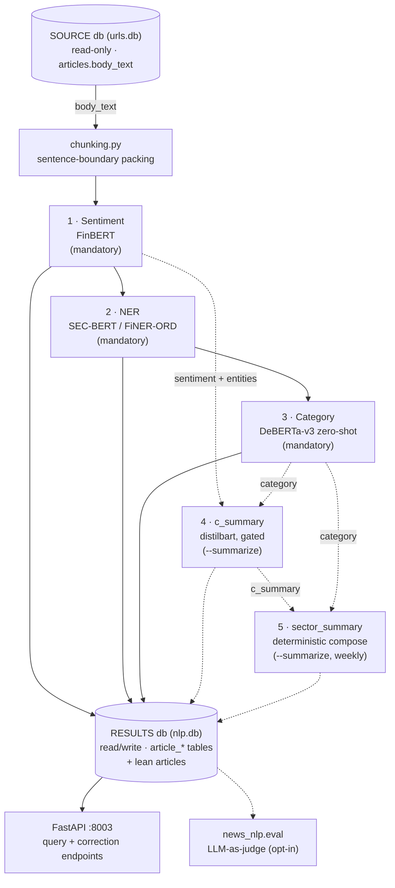

# Pipeline text superseded on 2026-11-10 (PLAN D39: the pipeline as the owner defined it)

Moved verbatim, IDs unchanged. Cut from the branch `feat/sentiment-pair-trainer` at the merge of master (`ba61e6b`).
The replacement text is `PLAN.md` D39 and the entries named in each section.

## PLAN.md D25 (replaced by D39)

- **D25 Order of the stages.** (1) the scope of the body; (2) NER, only for `single` and `multi`
  bodies; (3) a summary of every `single`, `sector`, `market_economy` and `investing_general` body (not `multi`, not `unrelated`); (4) for a `multi` body, the text each
  mentioned company gets; (5) sentiment, and the D15 category (D29), over the texts of steps 3 and 4;
  (6) company snapshots; (7) sector snapshots. `unrelated` stops at step 1 (D16). NER no longer
  runs on every body: sector, market / economy and `investing_general` bodies skip it.

## TASKS.md T-148 (P4; replaced by T-162 to T-168)

- [ ] **T-148** *(P4)* Texts, sentiment and category per (body, company), steps 3-5 of D25; each
      sub-task its own PR and its own FR when it ships. Single-company bodies use the whole summary;
      a dominated body (D23) is single + mentions; **the per-company category is accepted at >= 80%
      agreement with the owner's held-out gold (D24, confirmed)**. → P4.

## TASKS.md T-149 (P5; kept in a shorter form, sector path of D39 step 4)

- [ ] **T-149** *(P5)* Sector detection (GICS sector + sub-industry) for sector bodies;
      summaries of sector, market, economy and `investing_general` bodies feeding `sector_summary`,
      with `MARKET` / `ECONOMY` rows; **sector sub-industry detection accepted at >= 80% agreement
      with the owner's held-out gold (D24)**; its own FR. → P5.

## SPEC.md FR-001 (sentence about the new pipeline; the row stays, with a pointer to FR-020)

| **FR-001** | The sentiment stage runs `gamug/FinBERT-financial-news` (a continued fine-tune of `ProsusAI/finbert`, selected 2026-09-13 — §13 item 1) over every pending article's `body_text` (chunked, entity-scoped weighted average across chunks — full weight for chunks naming the article's own `company`/`ticker`, a lower baseline otherwise) and writes exactly one `article_sentiment` row per article. **Superseded for the new pipeline 2026-11-05 (PLAN D25/D26, T-148c): sentiment will read the summary or the company text, not the body, with no subject weighting; this FR describes the v1 tables until the backfill (T-150).** | After a pipeline run, every article with SOURCE text has an `article_sentiment` row with `label ∈ {positive, negative, neutral}`, `score`/`positive`/`negative`/`neutral` ∈ `[0, 1]`, and `model_name`/`processed_at` populated. |

## SPEC.md FR-004 (same)

| **FR-004** | The `c_summary` stage (opt-in, `--summarize`) generates one abstractive summary per article (`sshleifer/distilbart-cnn-12-6`, hierarchical reduce over chunks) **only** for articles that already have a sentiment row **and** at least one entity scoring `> 0.8`, writing `article_summary`. **Superseded for the new pipeline 2026-11-05 (PLAN D25, T-148a): the summary becomes a required step for every `single`, `sector`, `market_economy` and `investing_general` body, made before and not after sentiment, with no entity gate; this FR describes the v1 stage until the backfill (T-150).** | A normal (non-`--summarize`) pipeline run leaves `article_summary` untouched; an article failing the gate never gets a row even under `--summarize`; `num_chunks ≥ 1`. |

## SPEC.md section 4 (the diagram and the reading of it; the v1 diagram stays as the code of today)

## 4. System Architecture

**Reading this diagram**: solid arrows are the mandatory chain every
downstream consumer can rely on (stages 1–3, always run); dashed arrows are
the opt-in path (stages 4–5, only under `--summarize`) and the evaluation
subsystem (runs independently, off the same RESULTS store). `run_pipeline`
(`src/pipeline.py`) executes stages 1→2→3 unconditionally, then 4→5 only if
`summarize=True`, inside one process/one connection, `ATTACH`ing SOURCE
read-only and detaching it in a `finally` block.

Full detail, with hover tooltips per component: [the repository
artifact](https://claude.ai/code/artifact/65e62819-28dd-495b-b6ec-64f9c1751235)
referenced from `CLAUDE.md`. System-level placement of this repo among the
other five: [the architecture
overview](https://claude.ai/code/artifact/d3865a63-2894-4e20-b38a-7e50cf0d4040).

## SPEC.md section 6, "Batch pipeline run" (v1; stays as the code of today)

## 6. Core Workflows

**Batch pipeline run** (`cli/news_nlp_cli.py` → `pipeline.run_pipeline`):

1. Open RESULTS (`$DATABASE_URL`/`--results-db`), `ATTACH` SOURCE
   (`$SOURCE_DATABASE_URL`/`--source-db`) read-only.
2. `init_schema` (create-if-missing + additive migrations), then
   `require_source_text` — fail fast if SOURCE has no usable text.
3. Run sentiment → NER → category, each bounded by `--limit` if given, each
   skipping rows already present in its result table.
4. If `--summarize`: run `c_summary` (gated per-article), then
   `sector_summary` (closed weeks only).
5. Detach SOURCE, close the connection, print completion.

## PLAN.md D38 (long form; a short form stays in PLAN.md)

- **D38 Common words and surnames are not companies in the counts (T-161, PR #155; follows D37 of #154).** 15 tickers had counts far too high (FRT, STT, UNP, BE, XYZ, ...). **Cause:** the text matcher `CompanyResolver` (not the NER model, decision (k)): first-word aliases ("Federal", "Bloom") and one-word names ("Block"); retraining the NER would not change them. **Owner, 2026-11-09:** fold the other aliases into #155; CSV re-run after #155; redraw the gold pool and marks after the last matcher PR.
  **Change (built; the owner decides by merging):** (1) a hyphen, dash or apostrophe in a name reads as the space it replaced, a line break does not; (2) `_COMMON_FIRST_WORDS` join `_ALIAS_STOP`; (3) short forms and `_KNOWN_NAMES` count in themselves; (4) `_CORROBORATED` count only with another form of the company in the body, in `resolve` and `GuardedResolver` (`firm_spans`); (5) `_WORD_NAMES` capitalised only; (6) `_WORD_TICKERS` only with an explicit form; (7) stored NER spans obey the same rule; (8) names with upper-case initials, "!" and accents are found (AOS, CHRW, DHI, JBHT, SJM, TROW, USB, WRB, YUM, EL).
  **Measured** (everything, with the label file, in `docs/matcher_measurements_2026-11-09.md`): pairs 12,352 to 9,807 on a sample of 4,001 bodies (FRT 579 to 0, BE 97 to 2); precision of what is kept 94-97% by rule, the first-word alias rule 63% before the last edit and 88% on a sample no edit was chosen from; scope agreement on the 720: 0.696 to 0.700. **The disclosure column** `*_bodies_disclosure` (owner's decision (a)): 11.7-12.9% of the counted pairs, a reading by patterns (on a clean sample 40 of 40 flagged were disclosures, about 1 in 10 missed); `subject` and `single` not adjusted (5.2-7.3%, 0.3-0.7%).
  **The scope moves (round 8):** on the backtest window 5.6% of bodies change rule scope, 12.5% their subject companies, 1.0% enter the set that gets a summary and 0.3% leave it; on every `ok` body single +3.8 points, single + mentions -3.0. Figures documented with the old matcher (`docs/evaluation.md` sizing table, the held-out `frame` weights, T-148a) are marked "matcher at 786766f", not recomputed; the held-out gold keeps its strata. **The cut:** see (e).
  **Decided (owner, 2026-11-09, second session):** (a) the separate column; (b) the ten names fixed in #155; (c) no more list edits; (d) the attribution checkpoint `data/models/attribution_2026_11_08` (unpublished; old masks) is retrained after the CSV run and T-153; (e) **the cut is frozen as built** (manifest rules `f0a251aaf437`; reading it does not check them; the ~290 bodies the new rules would summarise get none); (f) #155 is not merged yet: one more review round. **Open:** USB, MSCI, ICE, MPC, DRI are tickers or acronyms, mixed; the CSV (T-160) is re-run after #155, before T-153 (D36 (j)).

**Owner answers for P2/P3 (2026-10-29), folded into D18/D20 above. No question is open.**
- *Q1* gate on a fixed 240 of the 720, at most 5 iterations; *Q2* point estimate with interval; *Q3*
  the held-out gold is drawn once before any training and excluded from every active-learning round
  (its tags are training data never); the one exception is Q4's second pass on about 50 of its
  bodies, which measures the label ceiling and is not used for training; *Q4* the owner re-tags all
  720 under the new taxonomy with the tags v1 shown as guidance: gold v2, not an independent
  consistency measure, so the ceiling is measured on the ~50 held-out bodies tagged twice a week
  apart (the owner agrees when they are drawn); order: labelling spec v2, re-tag file, then the
  gate on gold v2; the rules' 0.70 is re-measured on gold v2; *Q5* if the classifier stalls below
  its target the work stops and the owner decides; no LLM is added to the pipeline (D12).
- **Answered 2026-10-29.** *Q6 sampling frame:* custom rules prefilter the candidates for each rare
  scope (sector, market / economy, unrelated, `investing_general`), and the owner verifies a sample of
  **50 prefiltered articles** by hand before the held-out gold is drawn from them. Caveat recorded:
  the 50 check the filter's precision; its recall (rare-scope bodies the filter misses) stays
  unmeasured unless a random check sample is also read, and the inverse-sampling-fraction weights are
  valid only for strata defined before the draw, so rare-scope recall figures from this gold are
  conditional on the filter. *Q7 rounds:* **2 active-learning rounds** (about 300 bodies each) before
  the owner is asked again; owner effort about 1,070 bodies before round 1 plus about 600. *Q8 silver
  beyond scope:* per-company category and sub-industry silver labels are bought only at **>= 80%
  agreement with gold v2 on the 240** (the D24 bar); below it silver stays scope-only. *Q9 filter
  misses:* the held-out gold adds **~60 bodies drawn at random from outside the prefilter**, weighted
  by inverse sampling fraction, so per-scope recall (D20) includes what the filter misses; these
  are a third set of bodies, separate from the 50-article filter check and the 50 double-tagged.
  *Q10 calls per body:* **one call per body**; the reply lists every company with its D15 label, so
  the 240-call iteration and the 4,320 ceiling hold. Owner tagging tally: 720 re-tag + ~300
  held-out + ~60 misses + 50 filter check + 50 double-tag = about 1,180 bodies before round 1
  (the heavier tagging: scope, companies, D15 label per company, sub-industry), then 2 x ~300.

**Approach** (one PR per phase; each new table is proposed to the owner in the PR that needs it):

1. **P1 — foundations and sizing (T-144, T-145).** A read-only script counts unique bodies and
   resolves the companies each one names (name and explicit ticker forms, NER `ORG` spans matched
   to universe names; the upstream alias table of T-132 when it arrives), then gives rule-based scope
   candidates and a GICS guess, and scores the rules against the owner's 720 tagged articles. No
   spend, no schema change.
2. **P2 — labels (T-146).** Labelling spec v2, the revised prompt, the D18 silver labels and the
   owner's ~300 gold bodies.
3. **P3 — triage stage (T-147).** On unique bodies: the scope first (single company,
   several companies, sector, market / economy, `investing_general`, `unrelated`) from a local classifier (a fine-tuned
   small encoder over the text, the P1 rule features as inputs) trained on silver and gold, with
   active-learning rounds on its low-confidence bodies (D21) until it reaches >= 90% on the
   held-out gold (D20). Sketch of the tables: a body table keyed by body hash with its member pairs, and a
   per-body triage row (scope, companies, confidence). NER then runs on `single` and `multi`
   bodies only (D25).
4. **P4 — texts, sentiment and category (T-148).** The summary of every non-multi body (the pinned
   local summariser, step 3); for a multi body, the text of each company (step 4, D27: the
   one-segment-per-company parser, then the trained attribution model); then sentiment and the D15
   category over those texts (D26, D29), with the 180-text sentiment gold.
5. **P5 — sector, market and economy news, and the snapshots (T-149, T-152).** GICS sector /
   sub-industry detection, summaries of those bodies into `sector_summary` with `MARKET` /
   `ECONOMY` rows, and the company and sector snapshot tables (D28).
6. **P6 — backfill and close-out (T-150).** Re-process the stored corpus, update the
   knowledge-graph export contract, close Work items 15, 17 and 18 into `CHANGELOG.md`.

**Acceptance.** Every body has a scope, which agrees with the owner's held-out gold on >= 90% of
bodies (corpus-weighted point estimate, interval reported) and reaches recall >= 80% in each of the six
scopes (point estimate, interval reported; the floor applies to a scope with at least 40 gold bodies, D20 as amended by D33), measured with the
complete metric set (AI #12); the per-company category (P4) and the sector sub-industry (P5) each agree
with the held-out gold on >= 80% (D24, confirmed); no multi-company, sector, market or economy body is labelled `other`;
per-company sentiment and category exist for every company a body is about, computed on its
summary or company text (D26); company and sector snapshots exist, one row per body (D28); `sector_summary`
carries sector articles and `MARKET` / `ECONOMY` rows; the knowledge-graph export is updated and
documented; SPEC gains one FR per behaviour shipped.

## TASKS.md T-153 (long form; a short form stays)

- [ ] **T-153** *(coordination)* Reply to `portfolio-financial-analysis` (`to_nlp_backtest.md`, their 8
      questions): the training-data facts (about 30% of the sentences and bodies are from 2022 on, the
      labels have no date cut-off, nothing limits hindsight), what is decided (D31, D34) and what is not, their question 4 (which bodies count: the `role` column
      separates analysed from mention-only, D23), question 6 (running the pipeline on a SOURCE they provide: not yet; the cut covers the stored corpus, which ends 2026-08-12, and the bodies they add are not in it), question 8 (the agreement figures travel with the output and are in `PLAN.md` D32), `pub_date` formats (24 and 20 characters and empty, UTC not yet checked),
      the backtest cut (T-154: provisional, delivered about 2026-11-16 if the 2026-11-12 go/no-go holds) and the latest date their runs can use, and the final tables once T-152 is approved. Written for the owner's approval; nothing is sent. **Owner, 2026-11-09: sent after the company CSV run of T-160 (PR #152)**, so the reply carries the per-company counts and the coverage of the preserved corpus (D36 (j)). **Proposed, not decided (manager's review of #153):** if the company CSV is not done by the proposed date 2026-11-11 (the day before the 2026-11-12 go/no-go; the owner sets it), the owner decides whether to send the reply without it and say the per-company counts follow. When the owner answers, this line is replaced by the decision and its date.

## TASKS.md T-146e (end of the entry, the original plan)

        any training. *As drawn (D30): all 39 bodies the rules call no-company, sector, market or economy,
        the rest a seeded random draw from the 1,000-body sample; the original plan below (candidates
        prefiltered by custom rules, 50 of them checked by the owner first (Q6), ~60 random bodies from
        outside the filter (Q9), about 50 held-out bodies tagged twice (Q4)) is not what was drawn.*

## Out of the MVP (market, economy, investing_general, unrelated; D39)

PLAN.md D14 clause: market and economy news become `MARKET` / `ECONOMY` rows there;

PLAN.md D22 clause: D22 six scopes (the MVP handles three, D39): single company, several companies, sector, market / economy,
`investing_general` (investing or market-advice content about no company and no sector, the owner's
`other` tag: no per-company analysis, summarised in the `MARKET` row of `sector_summary`) and `unrelated`;

TASKS.md T-146e1 (verbatim):

      - [ ] **T-146e1** Prefilter rules for sector / market-economy / unrelated / `investing_general`
        (tests; measured on gold v2); the same candidates feed T-146d's oversampling.

## Out of the MVP, second cut (owner 2026-11-10): ops and test hygiene; the replaced attribution model and the LLM silver labelling

### TASKS.md entries, verbatim

- [ ] **T-022** *(maintainer)* Decide whether a bulk re-extraction of the
      remaining ~439,000 pre-fix `article_entities_v1` articles (not
      resampled by T-025) is worth doing — the fix is future-runs-only by
      design (`docs/evaluation.md` 2026-09-10 follow-up, "Scope"). No
      longer blocking T-020 (T-025 unblocked it with a smaller sample);
      this is now purely about full-corpus coverage. → step 3.

- [ ] **T-032** Re-solve `docs/evaluation.md`'s "Sample-size floor" purity
      estimates using T-031's actual measured per-stratum agreement
      (`strata_json` / `agreement_rate_target_negative` etc.) instead of
      today's planning-only estimates, before locking in a permanent
      `--sample-size` default. → step 3. **Still open** — not done as
      part of the 2026-09-13 fine-tuning work; the four real evals give
      more empirical grounding than before but the purity-estimate
      re-solve itself hasn't been done.

- [ ] **T-062** Tune `NER_BATCH_SIZE` empirically against the 6GB VRAM
      budget (SPEC.md NR-001) and measure the real throughput improvement
      (articles/sec) on a real sample (mirrors T-025's resample as a
      before/after comparison) — don't assume batching helps without
      measuring it, and don't copy `CATEGORY_BATCH_SIZE`/
      `SUMMARY_BATCH_SIZE`'s values blind (NER's per-chunk sequence
      length and variable chunks-per-article shape a different memory
      profile). **Not done — needs the project's actual GPU**, which the
      environment T-060/T-061 shipped from doesn't have (CPU-only
      sandbox); `NER_BATCH_SIZE=8` is an untested starting guess, not a
      measured value. → steps 5, 7.

- [ ] **T-156** *(test hygiene, 2026-11-06)* Flaky test `tests/news_nlp/test_eval_calibration_judge.py::test_an_interrupt_cancels_the_queue_instead_of_paying_for_it`: failed once in CI (PR #129, `assert 4 <= 3`), passed on the next run. It counts calls made by worker threads against a 0.05 s sleep, so the bound depends on timing. Fix: bound by the number of workers plus one, or stop the queue with an event instead of a sleep.

- [ ] **T-157** *(Windows, T-148a, 2026-11-07; PR #134, `docs/db-topology.md`)* The summaries cut's run lock probed a pid with `os.kill(pid, 0)`, which terminates on Windows. **Done:** the probe uses `OpenProcess` + `WaitForSingleObject`; the lock holds the pid and the process start time; Ctrl-Break stops like Ctrl-C; a `win32`-only test. Decision: no Windows CI job. **Closes when** the owner has resumed the cut once on Windows with a leftover lock and got no refusal. **Open:** taking over a stale lock is not atomic (chunk files are, so only work is duplicated); a lock of this version reads as stale to an older script; closing the console window cannot be caught. → T-148a. Full text before 2026-11-08: `.specify/memory/archive/TASKS-open-entries-2026-11-08.md` § T-157.

- [ ] **T-148b2** Training set for the attribution model from the structured bodies (company name masked, previous sentence as context, all years). **Built** (`scripts/build_company_segments_2026_11_05.py`, `gold/company_segments_train.csv`, ids and positions only): 2,834 bodies, 33,624 segments (21,682 `lead`, 11,942 `continuation`), 1 body in 10 as `val` (205 before 2022, 65 from 2022 on, reported apart); the 33 bodies that share text with a tagged or held-out article are left out; `tests/news_nlp/test_company_texts.py` pins the parser constants and counts. Built 2026-11-06: the mention-and-recency baseline (`news_nlp.attribution_baseline`) and the label check (100 `lead` + 100 `continuation`, `gold/segment_check_gold.csv`).
      - **Rule fixed before the check (owner, 2026-11-06):** `continuation` is dropped from training if at most 80% are right. **Read:** `lead` 88.0% [80.2, 93.0], `continuation` 38.0% [29.1, 47.8], so the model trains on `lead` only (PLAN D27). Acceptance (D32): at least 80% of the companies named in the faithfulness bodies with a faithful text, and better than the baseline on the same bodies; read in T-148b10. → D27, D32. Full text before 2026-11-08: `.specify/memory/archive/TASKS-open-entries-2026-11-08.md` § T-148b2.

- [ ] **T-148b3** *(trained model, merged, #141; **not published, not pinned**)* The trained attribution model (`src/news_nlp/attribution_model.py`, `scripts/train_attribution_2026_11_08.py`, `CompanyResolver.mention_spans`, `draw_faithfulness --attribution-model`). Trains on `lead` rows only (D27, label check 2026-11-06; the run refuses to start unless `gold_metrics.train_on_lead_only` is true); bodies it cannot attribute are flagged `unextracted`, never given a default text.
      - **Left (owner's word):** publish, the pin in `config/pipeline_models.json` under `attribution` with its revision, the `ExperimentSpec` stage. The model behind every `units` figure is the local directory `data/models/attribution_2026_11_08` (`local:8399ccf003c60143`).
      - **Open question (proposed, not decided):** the model has not learned to answer "none of these": a sentence about a company outside the universe goes to the nearest one (wrong cases scored 0.9 or more, so a higher threshold does not help; (c) is not supported). Options: (a) retrain with negatives that belong to nobody; (b) measure again after the stricter cuts of #143 and #144. One-word names (`JPMorgan`) are not read by the resolver (T-148b7). → D27. Full text before 2026-11-08: `.specify/memory/archive/TASKS-open-entries-2026-11-08.md` § T-148b3.

- [ ] **T-148b7** *(owner's decision 2026-11-07)* Person names and common words ("home", "union") that the guard does not stop: an item of its own, **after the cut** (not before it), to be measured against the owner's next tagging round. Nothing is built for it now.

- [ ] **T-146c** Revised LLM labelling prompt and gate: iterate on a fixed stratified 240 of gold v2 (at most 5 iterations, about 240 calls each), then the full 720 (480 new calls) at >= 90% scope agreement. Silver D15 labels and sub-industries are bought in P2 only if a second gate on the 240 (per-company category and sub-industry agreement with gold v2, >= 80%) passes; otherwise silver is scope-only. Budget: silver <= 6,000 - 240k - 480 for k iterations; judge repairs count against the 6,000.
      - The 240 is drawn once by `scripts/draw_gate240_2026_11_04.py` (quotas in `retag.GATE_QUOTAS`; local `data/gate240_ids.csv`); the owner tags it in `data/gate240_to_tag.csv`. The tracked gold files are `gold/category_gold_v2.csv` (240 + 44 sector) and `gold/category_gold_v2_test.csv` (200 held-out, #142), built by `scripts/build_gold_2026_11_05.py`; the article text stays out of git. Workflow: `docs/labelling-spec-v2.md`, "The fixed 240 of the prompt gate".
      - Owner calls 2026-11-05: company labels on sector/market_economy/investing_general bodies, several labels per company, `sub_industry` as GICS codes of any level; 44 more sector-like bodies were drawn for the sub-industry gate. → P2, D18. Full text before 2026-11-08: `.specify/memory/archive/TASKS-open-entries-2026-11-08.md` § T-146c.

      - [ ] **T-146d** Silver: at most 4,320 bodies, bought only after T-146c passes, oversampling
        the candidates for the rare scopes.
      - T-146e1 (prefilter rules for market, economy, unrelated, `investing_general`): out of the MVP, D39 (`archive/PIPELINE-superseded-2026-11-10.md`).

## Work item 2 — Make the regression gate runnable (ops, blocked on maintainer)

- [ ] **T-010** *(maintainer)* Designate/stand up a machine with durable
      access to `$SOURCE_DATABASE_URL`/`$DATABASE_URL` and a persistent
      `mlruns` dir or MLflow server. → `PLAN.md` Work item 2, step 1.
- [ ] **T-011** *(maintainer)* Register it as a GitHub self-hosted runner
      labeled `thesis-data`. → step 2.
- [ ] **T-012** *(maintainer)* Add repo secrets: `LLM_API_KEY`,
      `LLM_MODEL`, `LLM_URL`, `MLFLOW_TRACKING_URI`,
      `SOURCE_DATABASE_URL`, `DATABASE_URL`. → step 3.
- [ ] **T-013** Edit `.github/workflows/eval.yml`: uncomment
      `runs-on: [self-hosted, thesis-data]`, remove the
      `runs-on: ubuntu-latest` placeholder. → step 4. (Code change, but
      meaningless without T-010–T-012 done first — don't land this alone
      expecting it to work.)
- [ ] **T-014** *(maintainer)* Trigger `workflow_dispatch` once; confirm a
      real MLflow run + `eval_run` row is produced. → step 5 / first
      acceptance criterion.
- [ ] **T-015** *(maintainer)* Confirm the gate actually gates: induce a
      regression (temporarily lowered `--regression-tolerance`, or a
      second run compared against a known-worse one) and confirm the
      workflow fails. → second acceptance criterion.
- [ ] **T-016** Update `SPEC.md` §13 item 8 to reflect the resolved (or
      deliberately re-scoped) state. → third acceptance criterion. Also
      update the two architecture artifacts per constitution AI behavior
      #11 — reconcile, never rename.

### PLAN.md Work item 2, verbatim

## Work item 2 — Make the `--check-regression` gate runnable

**Why**: `.github/workflows/eval.yml` already invokes
`cli/news_nlp_eval.py … --check-regression` — the code-level gate
`SPEC.md` §13 item 8 was originally written as missing already exists.
What's actually missing is the *infrastructure* the workflow's own header
comment says it assumes and doesn't have: a self-hosted runner with
`$SOURCE_DATABASE_URL`/`$DATABASE_URL` mounted, a persistent
`$MLFLOW_TRACKING_URI` for `--check-regression` to have a prior run to
compare against, and the `LLM_API_KEY`/`LLM_MODEL`/`LLM_URL` repo secrets.
On the current `runs-on: ubuntu-latest`, the workflow has no data to run
against — it's a template, not a working gate, and its `schedule:` trigger
is presently running (or failing) against nothing.

**This is an operational task, not a code task** — constitution AI
behavior #10 ("ask before expanding scope") applies: standing up a
self-hosted runner and provisioning secrets is an infrastructure decision
for the repo owner to make and execute, not something to do
unilaterally inside a PR. This plan documents what's needed; a human
completes it.

**Steps** (for the repo owner/maintainer):

1. Stand up (or designate) a runner with persistent access to the working
   SOURCE/RESULTS SQLite files and a durable `mlruns` directory (or a real
   MLflow tracking server) — the same machine the manual
   `uv run cli/news_nlp_eval.py` invocations already run on is the
   simplest choice.
2. Register it as a GitHub self-hosted runner with (at least) the
   `thesis-data` label `eval.yml` already references in its commented-out
   `runs-on:` line.
3. Add the six repo secrets `eval.yml` reads:
   `LLM_API_KEY`, `LLM_MODEL`, `LLM_URL`, `MLFLOW_TRACKING_URI`,
   `SOURCE_DATABASE_URL`, `DATABASE_URL`.
4. Uncomment `runs-on: [self-hosted, thesis-data]` and remove/replace the
   `runs-on: ubuntu-latest` line beneath it.
5. Trigger once via `workflow_dispatch` to confirm the run completes,
   produces an `eval_run` row, and (on a second manual run) that
   `--check-regression` actually compares against the first.

**Acceptance criteria**:

- A `workflow_dispatch` run of `eval.yml` completes successfully on the
  designated runner and produces a real MLflow run + `eval_run` row.
- A deliberately-induced regression (e.g. temporarily lowering
  `--regression-tolerance` below a known noise level, or comparing against
  a run with a known worse metric) causes the workflow to fail — proving
  the gate actually gates, not just runs.
- `SPEC.md` §13 item 8 updated to reflect the new state (resolved, or
  re-scoped if the maintainer decides differently — e.g. keeping it
  scheduled-only rather than PR-blocking, which is a legitimate choice
  given the LLM cost of running this on every PR).

### PLAN.md D18, verbatim

D18 about 6,000 LLM labelling calls (a hard cap, logged in `docs/evaluation.md`, counted per
task, the run stops at it), the owner re-tags the 720 under the new taxonomy (v1 was tagged blind to the LLM label: the review file had no LLM column; the v2 file keeps it hidden and shows only the owner's v1 tag) (gold v2; the first tagging is "tags v1", a development
set), the revised prompt iterates on a fixed stratified 240 of them (at most 5 iterations) and must agree
with the owner's scope on >= 90% of the full 720 before silver is bought (at most 4,320 bodies: 6,000 minus
1,200 iteration calls minus 480 for the full pass; a 6th iteration is never spent without asking), and the
owner tags about 300 held-out gold bodies drawn across the corpus, at least 40 per scope (D30 drew 200 instead; D33: no top-up, and no recall floor for a scope under 40 gold bodies)
